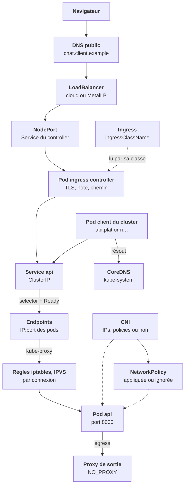
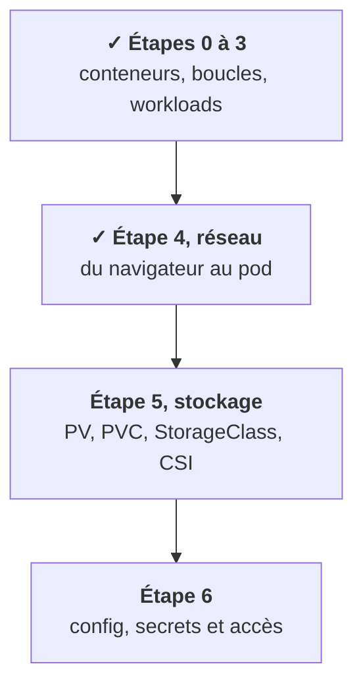

Toute l'étape suit **une requête**. Elle entre par un nom public, traverse un équilibreur, un controller, un Service, des règles kube-proxy, et arrive à un pod Ready. Chaque maillon peut casser, chacun a sa commande.

Regarde les couleurs : une **règle écrite** (violet) ne fait rien sans **quelqu'un qui l'applique** (ambre). Service et kube-proxy, Ingress et controller, NetworkPolicy et CNI : c'est trois fois la même histoire. Lance le pas à pas avec ▶, ou avance à ton rythme avec ›.

## Ce que tu sais faire maintenant

- **Énoncer le modèle plat** et demander quel CNI tourne chez le client. [Leçon 1](/l/04-reseau/01-modele-plat-cni/)
- **Lire les endpoints** d'un Service et donner les trois causes d'un `<none>`. [Leçon 2](/l/04-reseau/02-service-endpoints/)
- **Choisir un type de Service** et dénouer un LoadBalancer en `pending`. [Leçon 3](/l/04-reseau/03-types-service/)
- **Expliquer l'équilibrage par connexion** et ce qu'ajoute un mesh. [Leçon 4](/l/04-reseau/04-kube-proxy-mesh/)
- **Écrire le nom DNS complet** d'un Service et déjouer `ndots`. [Leçon 5](/l/04-reseau/05-dns-ndots/)
- **Distinguer Ingress et controller**, et vérifier la classe. [Leçon 6](/l/04-reseau/06-ingress-controller/)
- **Situer Gateway API** et l'API gateway de la plateforme. [Leçon 7](/l/04-reseau/07-gateway-api/)
- **Retracer la chaîne** d'entrée, et la sortie par un proxy. [Leçon 8](/l/04-reseau/08-chaine-complete/)
- **Lire une NetworkPolicy** et prouver qu'elle s'applique. [Leçon 9](/l/04-reseau/09-networkpolicy/)
- **Diagnostiquer dans l'ordre** et lire 404, 502, 503, 504. [Leçon 10](/l/04-reseau/10-diagnostic-codes/)

## Les mots de l'étape

| Mot | En une phrase | Au téléphone |
|---|---|---|
| CNI | Le plugin qui donne une IP à chaque pod et les relie. | L'installateur télécom |
| Service | Une adresse fixe devant des pods qui changent. | Le numéro du support |
| Endpoints | Les pods sélectionnés et Ready, à cet instant. | Les agents connectés |
| ClusterIP | Un Service joignable de l'intérieur seulement. | Un numéro interne |
| LoadBalancer | Un Service avec une IP externe fournie par le cloud. | Un numéro public de l'opérateur |
| kube-proxy | Les règles qui envoient l'IP du Service vers un pod. | L'aiguillage au décroché |
| CoreDNS | Ce qui transforme un nom de Service en IP. | L'annuaire interne |
| Ingress | Des règles « hôte et chemin vers Service ». | Le script du menu vocal |
| Ingress controller | Le proxy qui lit les Ingress et route. | L'automate qui lit le script |
| API gateway | Le composant qui vérifie identité et quotas. | L'agent qui demande ton numéro client |
| NetworkPolicy | La liste de ce qui reste autorisé entre pods. | Les restrictions d'appel |
| Proxy de sortie | Le passage obligé des appels vers l'extérieur. | Le standardiste et sa liste |

## Où tu en es dans la partie A

Tu sais maintenant où passe le trafic, et le prouver maillon par maillon. L'étape 5 s'attaque à ce qui doit survivre au pod : les volumes, et ce qui change d'un client à l'autre côté stockage, comme le CNI ici.

<Retenir>
Un Service ne vise que des pods sélectionnés et Ready ; `kubectl get endpoints` d'abord. Un Ingress sans controller de la bonne classe, une NetworkPolicy sans CNI qui l'applique : présents, acceptés, et sans effet. Remonte la chaîne maillon par maillon.
</Retenir>
