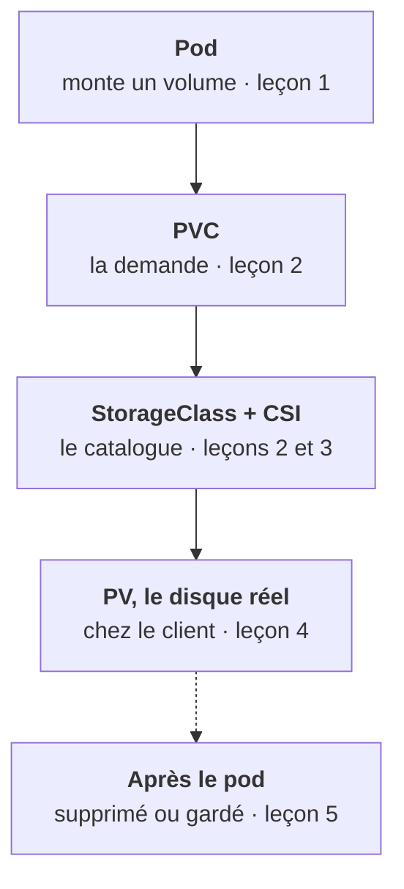
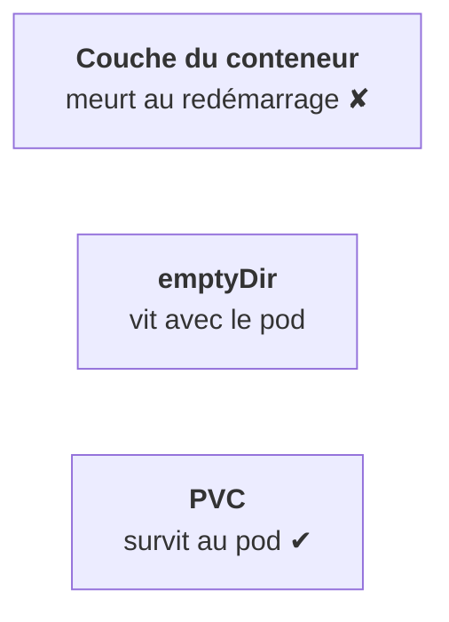

<Idee>
Le disque d'un conteneur est **jetable** : il disparaît avec lui. Tout ce qui doit survivre va dans un **volume**, déclaré par le pod. Le type de volume décide de sa durée de vie : celle du pod, ou au-delà.
</Idee>

<Analogie>
Le pod est un voyageur à l'**hôtel**. Ce qu'il laisse dans la **chambre** (le conteneur) est jeté au départ. Pour garder ses affaires, il loue un **box au garde-meubles** (le volume persistant), qui l'attend au prochain séjour, quel que soit l'hôtel. On garde cette image toute l'étape.
</Analogie>

## La carte de l'étape

Le stockage, c'est **une demande**, **un catalogue** et **un disque réel**, plus ce qui change chez chaque client. Chaque leçon zoome sur une boîte.

## Trois durées de vie

| Volume | Ce qu'il garde | Usage typique |
|---|---|---|
| `emptyDir` | ✔ un redémarrage de conteneur, ✘ un déplacement du pod | cache, partage init container et conteneur |
| `emptyDir` en mémoire | ✔ idem, en RAM | `/dev/shm` des serveurs d'inférence |
| `configMap`, `secret` | ✔ suit l'objet source | fichiers de config, certificats (étape 6) |
| `persistentVolumeClaim` | ✔ indépendant du pod | bases, files, tout ce qui compte |
| `hostPath` | ✘ collé au nœud | réservé aux agents système |

Un volume est déclaré une fois dans le pod, puis monté dans un ou plusieurs de ses conteneurs. C'est ainsi qu'un init container prépare un modèle que le conteneur principal lit ensuite.

<Terrain>
Le plan de données de la plateforme (bases, cache, bus, analytique) repose entier sur des PVC. Le stockage est **le** point où l'infra du client rencontre ton chart.
</Terrain>

<Piege>
Un `hostPath` dans un chart applicatif : non portable, et refusé par les politiques de sécurité de tout client sérieux.
</Piege>

<Retenir>
Le conteneur oublie tout. `emptyDir` vit avec le pod, un PVC survit au pod. Choisis le volume selon ce qui doit survivre.
</Retenir>
