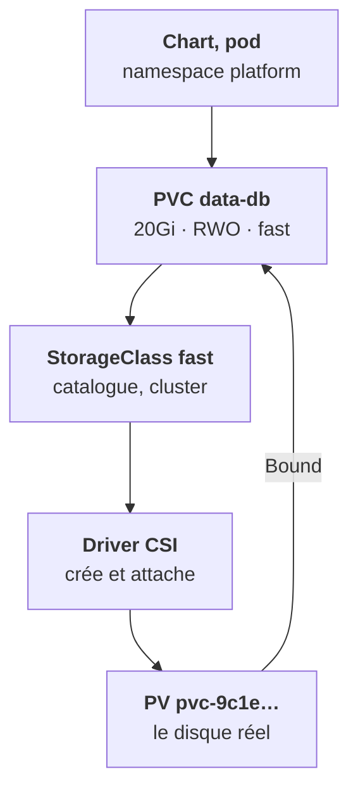

<Idee>
L'application **demande** du stockage (le PVC), le cluster a un **catalogue** de recettes (la StorageClass), et un **driver CSI** fabrique le **disque réel** (le PV) puis le lie à la demande.
</Idee>

<Analogie>
Le voyageur remplit un **bon de réservation** (« un box de 20 m², accès par moi seul »). Le garde-meubles a un **catalogue de formules**. Le **manutentionnaire** (CSI) construit le box selon la formule et y met l'étiquette du voyageur.
</Analogie>

## Qui écrit quoi

| Objet | Écrit par | Portée |
|---|---|---|
| PVC | ton chart | ✔ namespace |
| StorageClass | l'admin ou le cloud | cluster |
| PV | le driver CSI (ou un admin, à l'ancienne) | cluster |

Tu ne fabriques jamais les StorageClasses : ton chart doit vivre avec celles du client. Le **provisioning dynamique**, c'est le cas normal : le PV naît à la demande. Le **statique**, des PV créés à l'avance par un admin, se voit encore sur du NFS ancien.

Un driver CSI, c'est deux morceaux : un **controller** (Deployment) qui crée et attache les disques chez le fournisseur, un **plugin de nœud** (DaemonSet) qui les formate et les monte dans le pod. Sur GKE il est préinstallé ; on-prem, c'est le client qui l'a mis (vSphere, Ceph, Longhorn…), ou pas.

<Compare>
<Cas ton="ok" titre="Classe par défaut présente">

PVC sans classe : il prend la défaut, un disque naît, `Bound`.

</Cas>
<Cas ton="ko" titre="Pas de classe par défaut">

PVC sans classe : personne ne le prend. `Pending` pour toujours.

</Cas>
</Compare>

<Piege>
`storageClassName: ""` (vide) n'est pas « absent » : c'est « aucune classe », donc statique seulement. Une valeur Helm mal templatée produit ce PVC qui n'aboutit jamais.
</Piege>

<Retenir>
PVC = la demande (ton chart), StorageClass = le catalogue (le client), PV = le disque (le CSI). `kubectl describe pvc` dit toujours pourquoi ça bloque.
</Retenir>
