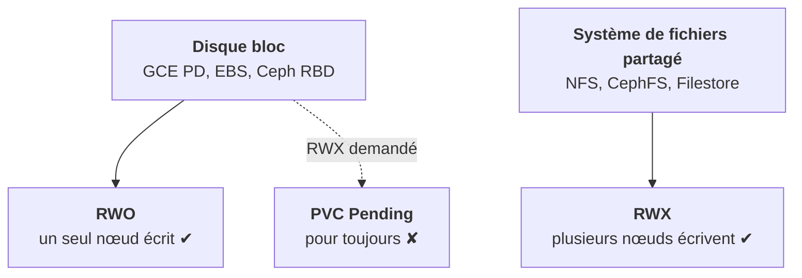

<Idee>
Trois réglages du catalogue décident de ton architecture : **qui peut écrire** sur le disque (un nœud ou plusieurs), **quand** il est créé (tout de suite ou là où va le pod), et **ce qu'il devient** quand on supprime la demande.
</Idee>

<Analogie>
Le **box** du garde-meubles : une seule clé ou une clé par colocataire ? Construit à l'avance au hasard, ou **dans la ville où tu t'installes** ? Et à la résiliation, on **vide le box** ou on le garde fermé ?
</Analogie>

## Qui peut écrire : RWO ou RWX

Le mode d'accès dit ce que **le stockage sait faire**, pas ce que le pod veut. Tous les disques savent RWO. Le RWX n'existe que sur un système de fichiers partagé, et c'est **la première question à poser chez un client** : quels composants du chart en ont besoin, et y a-t-il une alternative ? La plateforme stocke ses fichiers en stockage objet justement pour s'en passer.

## Quand il naît : la zone

Avec `Immediate`, le disque naît dès la demande, sans savoir où ira le pod. Sur un cloud multi-zones, disque en zone A, pod en zone B : le pod ne démarre pas. Avec `WaitForFirstConsumer` (le bon réglage, défaut des classes modernes), le disque attend le pod et naît dans sa zone.

## Ce qu'il devient : la reclaim policy

| PVC supprimé, classe en… | Résultat |
|---|---|
| `Delete` (défaut cloud) | ✘ disque et données détruits |
| `Retain` | ✔ disque gardé, PV en `Released`, à rattacher à la main |

<Terrain>
Pour les bases de production d'un client, demande une classe en `Retain`. C'est ce qui sépare une fausse manip d'une perte de données.
</Terrain>

<Retenir>
RWX n'existe que sur du stockage partagé : vérifie-le en premier. `WaitForFirstConsumer` place le disque dans la bonne zone. `Retain` protège les données d'une suppression.
</Retenir>
