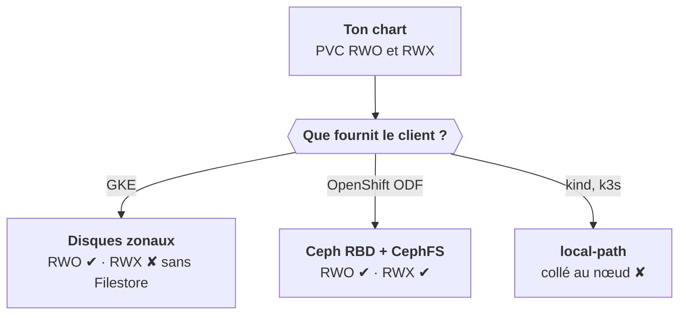

<Idee>
Ton chart demande des PVC, mais **c'est l'infrastructure du client qui répond**. Chaque environnement a ses classes, ses forces (RWX, snapshots) et ses pièges. Cinq questions avant d'installer évitent la plupart des blocages.
</Idee>

<Analogie>
Chaque ville a **son garde-meubles**. Ici pas de box partagé, là des box collés à un seul immeuble, ailleurs une enseigne qui exige trois copies de tout. Ton bon de réservation est le même partout ; la réponse, non.
</Analogie>

## Les environnements en bref

| Environnement | Ce qu'il faut savoir |
|---|---|
| GKE | ✔ RWO et snapshots. ✘ pas de RWX sans Filestore, coûteux. Disques zonaux. |
| OpenShift (ODF) | ✔ RWO (Ceph RBD), RWX (CephFS). UID arbitraire : `fsGroup` à ne pas fixer. |
| VMware (vSphere CSI) | ✔ RWO. ✘ datastore plein = PVC Pending sans message parlant. |
| Ceph, Rook | ✔ tout. Performances variables ; Ceph en alerte = tout ralentit. |
| Longhorn | ✔ tout. 3 répliques par défaut : un cluster à 2 nœuds dégrade tout. |
| NFS | ✔ RWX. ✘ jamais pour une base de données. |
| local-path (kind, k3s) | ✘ volume collé au nœud, pas d'agrandissement. |

## Les cinq questions avant de dire « ça va s'installer »

1. Y a-t-il une StorageClass par défaut, et laquelle ?
2. Une classe RWX existe-t-elle ? Sinon, quels composants en ont besoin ?
3. Les snapshots sont-ils supportés ? C'est la base des sauvegardes.
4. Quelle capacité reste-t-il réellement ?
5. Les disques sont-ils zonaux, et les nœuds sur plusieurs zones ?

<Terrain>
Les questions 1 à 3 se vérifient seul avec `kubectl get storageclass` et `kubectl get volumesnapshotclass`, avant même la réunion. Arrive avec les réponses.
</Terrain>

<Retenir>
Le même chart rencontre des stockages très différents. RWX, snapshots, capacité, zones : pose les cinq questions avant d'installer, pas après le premier PVC Pending.
</Retenir>
