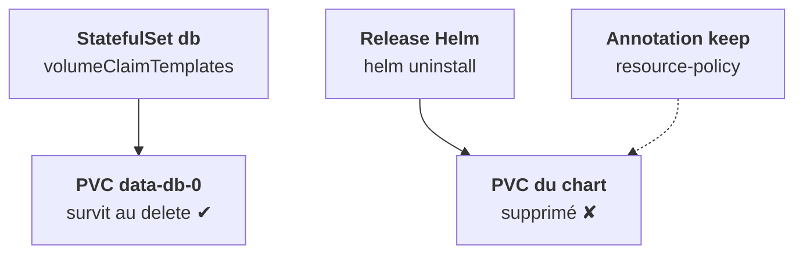

<Idee>
Les données ont leur propre vie. Un StatefulSet **garde** ses PVC quand on le supprime, `helm uninstall` **supprime** ceux déclarés directement, et un disque RWO **bloque** une mise à jour qui veut deux pods en même temps.
</Idee>

<Analogie>
Le voyageur part de l'hôtel : son **box** reste. Mais s'il **résilie le contrat** (uninstall), le box est vidé. Et un box à **une seule clé** ne peut pas servir à l'ancien et au nouveau locataire le même jour.
</Analogie>

Le modèle de volume d'un StatefulSet est **immuable** : un chart qui augmente une taille de disque à la mise à jour échoue, sauf s'il prévoit d'agrandir chaque PVC à part.

## Les pannes de stockage à reconnaître

| Symptôme | Cause probable |
|---|---|
| PVC `Pending` | ✘ pas de classe par défaut, classe inconnue, RWX impossible, capacité épuisée, pas de CSI. ✔ `waiting for first consumer` : normal |
| Pod `Pending`, volume `Bound` | ✘ disque dans une autre zone, ou collé à un nœud absent |
| `ContainerCreating` long | ✘ `Multi-Attach error` : disque RWO encore tenu ailleurs |
| `permission denied` | ✘ `fsGroup` absent, UID arbitraire OpenShift |
| PVC bloqué `Terminating` | ✔ un pod l'utilise encore : finalizer de protection, ne pas le forcer |

<Terrain>
Avant un `helm uninstall` sur un environnement qui compte, liste les PVC de la release : tu sais ce qui va disparaître et ce qui va rester.
</Terrain>

<Retenir>
StatefulSet : les PVC restent. `helm uninstall` : les PVC du chart partent. RWO à 1 réplica : `Recreate`, pas `RollingUpdate`. Et `describe` dit toujours la cause.
</Retenir>
