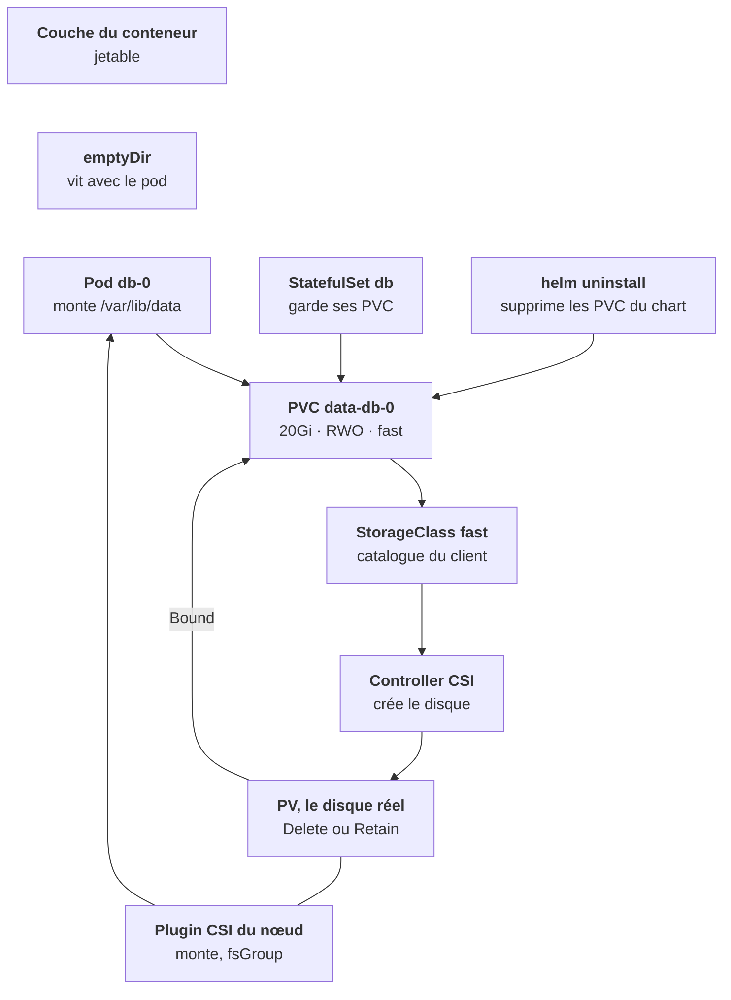
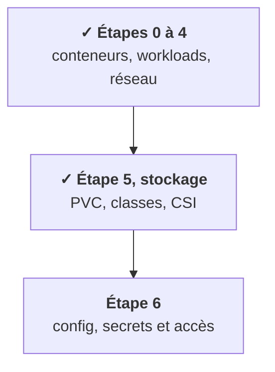

Toute l'étape suit **un disque**. Le chart le demande, le catalogue du client dit comment le fabriquer, le driver CSI le crée et le monte, puis il vit plus longtemps que le pod, ou pas.

Regarde les couleurs : **ton chart demande** (violet), **l'infrastructure du client répond** (ambre). C'est le fil rouge du stockage : tu ne choisis pas le disque, tu fais avec. Lance le pas à pas avec ▶.

## Ce que tu sais faire maintenant

- **Dire ce qui survit au pod** et choisir le bon volume. [Leçon 1](/l/05-stockage/01-ce-que-le-pod-perd/)
- **Expliquer PVC, StorageClass, PV et CSI**, et lire un `Pending`. [Leçon 2](/l/05-stockage/02-demande-catalogue-disque/)
- **Lire RWO et RWX, la zone et la reclaim policy.** [Leçon 3](/l/05-stockage/03-ce-que-le-disque-sait-faire/)
- **Poser les cinq questions stockage** à un client. [Leçon 4](/l/05-stockage/04-stockage-chez-le-client/)
- **Prévoir le sort des données** et reconnaître les pannes classiques. [Leçon 5](/l/05-stockage/05-donnees-apres-le-pod/)

## Les mots de l'étape

| Mot | En une phrase | Au garde-meubles |
|---|---|---|
| Volume | Un stockage déclaré par le pod et monté dans ses conteneurs. | Un rangement hors de la chambre |
| emptyDir | Un volume qui vit et meurt avec le pod. | Le placard de la chambre |
| PVC | La demande de stockage écrite par le chart. | Le bon de réservation |
| StorageClass | La recette pour fabriquer un disque. | Le catalogue des formules |
| PV | Le disque réel, lié à une demande. | Le box |
| CSI | Le driver qui crée, attache et monte les disques. | Le manutentionnaire |
| RWO, RWX | Un seul nœud écrit, ou plusieurs. | Une clé, ou une par colocataire |
| WaitForFirstConsumer | Le disque naît là où va le pod. | Box construit dans ta ville |
| Reclaim policy | Ce que devient le disque si on supprime la demande. | Box vidé ou gardé à la résiliation |
| fsGroup | Le groupe qui reçoit le volume au montage. | Le double de clé au bon nom |

## Où tu en es dans la partie A

Tu sais où vivent les données et ce qui les menace. L'étape 6 finit le socle : comment la configuration et les secrets entrent dans un pod, et qui a le droit de faire quoi.

<Retenir>
Ton chart demande, l'infrastructure du client répond. Vérifie la classe par défaut et le RWX avant d'installer, choisis `Retain` pour ce qui compte, et souviens-toi que `helm uninstall` supprime, pas `kubectl delete sts`.
</Retenir>
