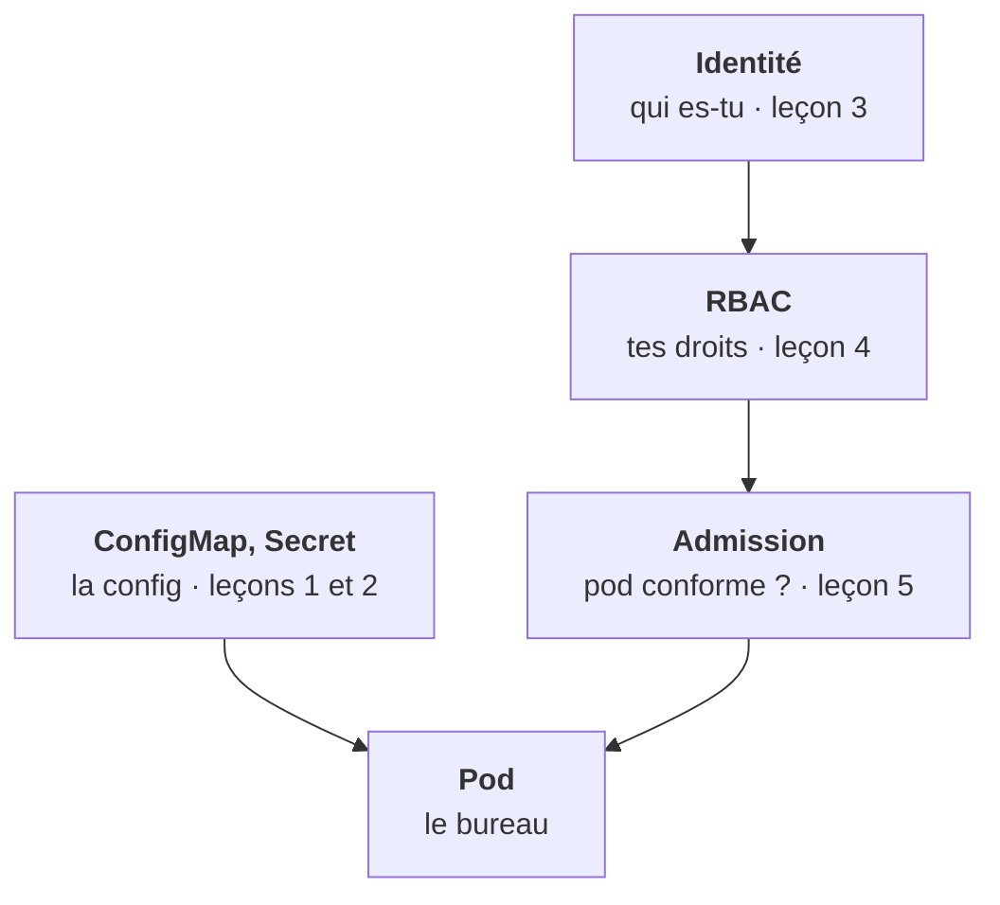
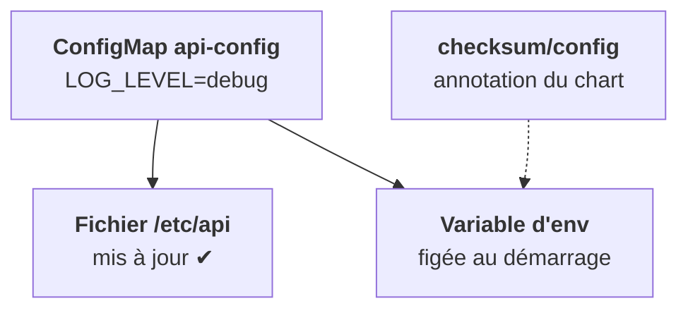

<Idee>
La configuration vit dans un **ConfigMap** (ou un **Secret** pour le sensible) et entre dans le pod **en variable** (lue une fois au démarrage) ou **en fichier** (mis à jour en place). Un chart bien fait redémarre les pods quand leur config change.
</Idee>

<Analogie>
La plateforme est un **immeuble de bureaux**. La config, ce sont les **notes de service** : soit **dictées à l'embauche** (variables, figées), soit **affichées au mur** du bureau (fichiers, remplacées quand la direction les change). On garde cet immeuble toute l'étape : badges, coffres, vigiles.
</Analogie>

## La carte de l'étape

Faire entrer config et secrets, puis contrôler **qui** entre et **ce qui** a le droit d'entrer.

## Variable ou fichier : la différence qui compte

| Consommation | Après modification du ConfigMap |
|---|---|
| Variable d'environnement | ✘ rien jusqu'au redémarrage |
| Fichier, répertoire monté | ✔ mis à jour sous une minute |
| Fichier monté avec `subPath` | ✘ copie figée, jamais rafraîchie |

Un Secret fonctionne pareil, avec quelques types en plus : certificats TLS, identifiants de registre d'images.

<Terrain>
« J'ai changé la config, rien ne bouge » : demande comment elle est consommée. Sans checksum dans le chart, un `helm upgrade` qui ne touche que la config ne redémarre rien, et le client croit sa nouvelle config active.
</Terrain>

<Retenir>
Variable = figée au démarrage. Fichier = mis à jour, sauf avec `subPath`. L'annotation checksum fait redémarrer les pods quand leur config change.
</Retenir>
