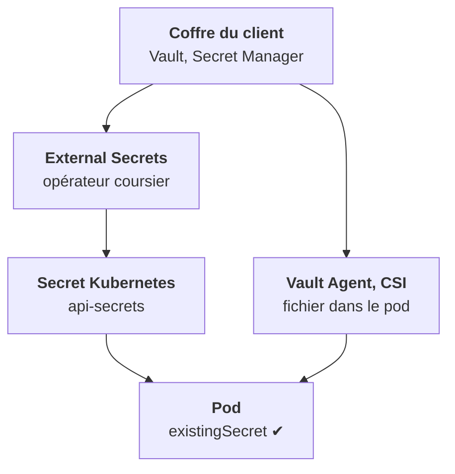

<Idee>
Un Secret Kubernetes est juste **encodé**, pas chiffré : c'est le **RBAC** qui le protège. Et chez un client, les secrets ne s'écrivent jamais dans un fichier versionné : ils arrivent **d'un coffre externe**, par l'outil qu'il impose.
</Idee>

<Analogie>
Le Secret, c'est une **enveloppe pliée** dans le bureau : n'importe qui peut la déplier. Ce qui la protège, c'est **qui a le badge** pour entrer dans la pièce. Les vrais objets de valeur sont au **coffre-fort de la banque** (Vault) ; un **coursier** (ESO) en apporte une copie au bureau.
</Analogie>

## Ce qui protège un Secret

1. Le **RBAC** : qui a le droit de lire les secrets de ce namespace (leçon 4). C'est la seule barrière côté cluster.
2. Le **chiffrement au repos** d'etcd : activé par défaut sur GKE, à vérifier on-prem.
3. **Rien dans git** : ce qui pose la question de leur arrivée.

## Les trois façons dont un client injecte ses secrets

| Famille | Comment | À savoir |
|---|---|---|
| External Secrets (ESO) | un opérateur lit le coffre et écrit des Secrets ordinaires | ✔ le plus répandu, transparent pour le chart |
| Sealed Secrets | un Secret chiffré dans git, déchiffré par un contrôleur | ✘ lié à un cluster, perdre la clé perd tout |
| Vault en direct | sidecar ou volume CSI, sans Secret Kubernetes | ✔ plus sûr, ✘ modifie les pods |

Ce que ça demande à ton chart : savoir dire « ce Secret existe déjà, ne le crée pas » (`existingSecret`), et accepter qu'un pod attende tant que le secret n'est pas synchronisé.

<Terrain>
Même logique pour les images : depuis un registre privé, il faut un secret d'identifiants (`imagePullSecrets`), au mieux posé sur le ServiceAccount. `unauthorized` dans `describe` : identifiants. `x509` : CA du registre inconnue, classique en air-gapped.
</Terrain>

<Retenir>
base64 n'est pas un chiffrement, le RBAC est la vraie barrière. Chez un client, demande **comment les secrets arrivent** avant de demander les secrets.
</Retenir>
