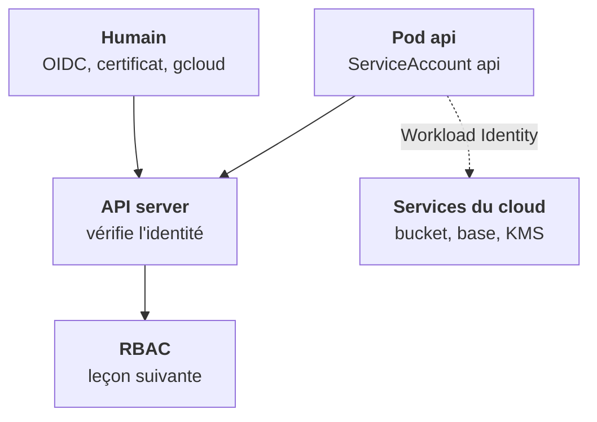

<Idee>
Kubernetes **ne connaît pas d'utilisateurs**. Un humain prouve qui il est avec une identité **venue d'ailleurs** (certificat, annuaire de l'entreprise, compte cloud). Un pod, lui, a un **ServiceAccount**. Sur un cloud, un pod a même une **seconde identité** pour parler aux services du cloud.
</Idee>

<Analogie>
L'immeuble ne tient pas de registre des visiteurs : il fait confiance à la **carte d'identité** délivrée par l'État (l'annuaire du client). Les employés-machines, eux, reçoivent un **badge** maison (le ServiceAccount). Et pour aller à la banque d'en face (le cloud), il faut **un autre badge**.
</Analogie>

## Les humains

| Source | Où tu la vois |
|---|---|
| Certificat client | ✔ kind, kubeadm : ton `~/.kube/config` |
| Token OIDC | ✔ en entreprise : Keycloak, Google, Entra |
| Identité cloud | ✔ GKE : `gcloud` obtient un token de ta session |

## Les pods

Un **ServiceAccount** est un objet namespacé. Son token est déposé automatiquement dans chaque pod, et c'est avec lui que le pod parle à l'API. Sans précision, un pod prend le ServiceAccount `default`.

<Compare>
<Cas ton="ok" titre="Chart sérieux">

- un ServiceAccount par composant
- token non monté si le composant ne parle pas à l'API

</Cas>
<Cas ton="ko" titre="Chart négligé">

- tout tourne sous `default`
- chaque pod porte un token inutile

</Cas>
</Compare>

<Terrain>
Sur un cloud, deux identités : une pour Kubernetes, une pour le cloud. Un pod qui a les droits RBAC mais pas le compte de service Google lié ne lira pas son bucket.
</Terrain>

<Retenir>
Pas d'utilisateur dans Kubernetes : les humains viennent de l'annuaire du client, les pods ont un ServiceAccount. Sur un cloud, un pod a deux identités.
</Retenir>
