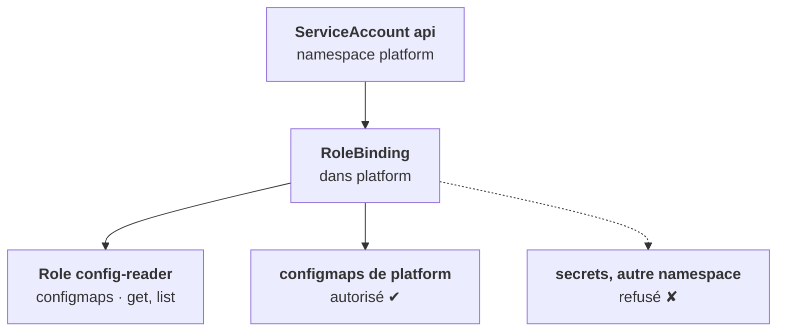

<Idee>
Dans Kubernetes, **tout est refusé par défaut**. Un **Role** liste des droits, un **binding** les donne à quelqu'un, dans un namespace ou partout. Les droits s'additionnent, il n'y a jamais d'interdiction.
</Idee>

<Analogie>
Le **badge** n'ouvre aucune porte au départ. On y ajoute des **accès** : « étage 3, salle des archives, en lecture ». Le Role, c'est la liste des portes ; le binding, c'est l'**encodage sur le badge** de quelqu'un, pour un étage ou tout l'immeuble.
</Analogie>

## Les quatre objets

| Objet | Portée |
|---|---|
| Role | une liste de droits, dans un namespace |
| ClusterRole | une liste de droits, valable pour tout le cluster |
| RoleBinding | donne un Role **ou un ClusterRole**, dans un namespace |
| ClusterRoleBinding | donne un ClusterRole, partout |

C'est **le binding qui fixe la portée**. Un ClusterRole prédéfini (`view`, `edit`, `admin`) lié par un RoleBinding ne vaut que dans ce namespace : c'est la façon propre de donner des droits sans offrir le cluster.

Sur GKE, l'IAM de Google se superpose et se traduit en droits RBAC. Dans tous les cas, `kubectl auth can-i` reste la vérité finale.

<Terrain>
Les opérateurs ont besoin de ClusterRoles larges. Un client qui les refuse impose une installation restreinte à un namespace : à savoir dès le cadrage, pas le jour de l'installation.
</Terrain>

<Piege>
Accorder `list` sur `secrets` en pensant ne donner que des noms : c'est le contenu de tous les secrets du namespace.
</Piege>

<Retenir>
Refusé par défaut, les droits s'additionnent, le binding fixe la portée. Avant de dire « je n'ai pas accès », prouve-le avec `kubectl auth can-i`.
</Retenir>
