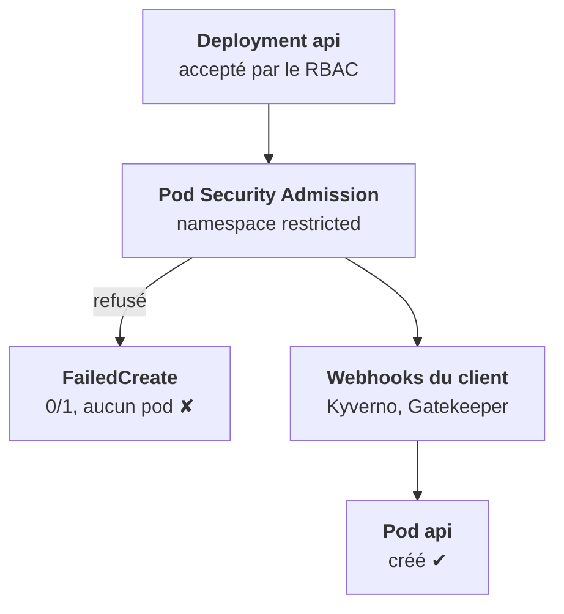

<Idee>
Le RBAC décide **qui** peut créer un pod. L'**admission** décide **à quoi un pod a le droit de ressembler** : un vigile contrôle chaque objet avant qu'il n'entre, et peut le **refuser** ou le **modifier**.
</Idee>

<Analogie>
Ton badge t'ouvre la porte (RBAC). Mais à l'entrée, un **vigile** applique le **règlement de sécurité** : pas de chaussures de chantier dans les bureaux, casque obligatoire en atelier. Certains immeubles ajoutent leurs **vigiles maison**, qui vous refusent, ou vous collent un badge visiteur en plus.
</Analogie>

## Trois niveaux, posés sur le namespace

| Niveau | Ce qu'il exige |
|---|---|
| privileged | rien : réservé aux agents système (CNI, CSI, GPU) |
| baseline | interdit le pire : mode privilégié, accès à l'hôte |
| restricted | non-root, pas d'escalade de privilèges, capacités retirées, profil seccomp |

Un chart destiné aux clients doit passer **restricted** partout où c'est possible. Le symptôme d'un refus est très reconnaissable : le Deployment existe, **aucun pod n'apparaît**, et les events disent champ par champ ce qui manque.

## Ce que le client ajoute

**OpenShift** a son propre vigile, les SCC : elles imposent un UID arbitraire, donc un chart ne fixe pas d'UID. Beaucoup de clients ajoutent des **webhooks** (Kyverno, Gatekeeper) avec leurs règles : pas de tag `latest`, limites obligatoires, registres autorisés. Les webhooks **mutants** modifient tes objets en silence.

<Terrain>
Quand ce qui tourne ne ressemble pas à ce que ton chart a rendu, compare `helm template` avec `kubectl get -o yaml` : l'écart vient presque toujours d'un webhook mutant.
</Terrain>

<Retenir>
RBAC = qui crée ; admission = à quoi ressemble ce qui est créé. Deployment à 0/1 sans pod : lis les events, c'est un refus d'admission.
</Retenir>
