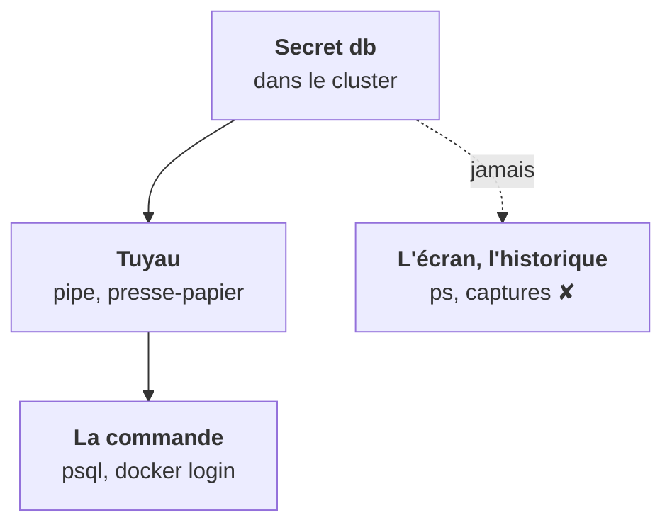

<Idee>
Un secret ne passe **jamais par l'écran** ni **en argument** d'une commande : il va du coffre à la commande qui en a besoin, par un tuyau. Et avant de demander un accès, tu **prouves** ce qui te manque.
</Idee>

<Analogie>
Le code du coffre ne s'**écrit pas au tableau** pendant la réunion, ni sur un post-it collé à l'écran. Il passe **de main en main**, dans une enveloppe. Et à l'accueil, on ne dit pas « mon badge ne marche pas » : on montre **quelle porte** refuse.
</Analogie>

## Les réflexes

| Geste | Résultat |
|---|---|
| Décoder le secret à l'écran | ✘ scrollback, historique, transcription, partage d'écran |
| Le copier dans le presse-papier | ✔ rien ne s'affiche |
| `--set password=…` ou `-p …` | ✘ visible par `ps` et dans l'historique |
| Fichier hors git (droits 600) ou stdin | ✔ rien ne traîne |
| « Je n'ai pas accès » | ✘ un aller-retour perdu |
| `kubectl auth can-i` puis la demande précise | ✔ le client accorde du premier coup |

Pour l'historique du shell : une espace devant une commande sensible suffit, si le shell est réglé pour ignorer ces lignes.

## Deux logins sur un cloud

Sur GCP, ta session `gcloud` (pour gcloud et kubectl) et les **Application Default Credentials** (pour les SDK et outils internes) sont indépendantes. L'une qui marche ne prouve pas l'autre. Et l'avertissement « ADC sans quota project » est **inoffensif** : il ne bloque rien.

<Terrain>
Le kubeconfig d'un client est un secret : droits 600, jamais dans un dépôt ni un message, et un fichier par client pour qu'un mauvais contexte soit impossible.
</Terrain>

<Retenir>
Ni écran, ni argument : un secret voyage par tuyau ou par fichier. Prouve tes accès avec `auth can-i` avant d'en demander.
</Retenir>
