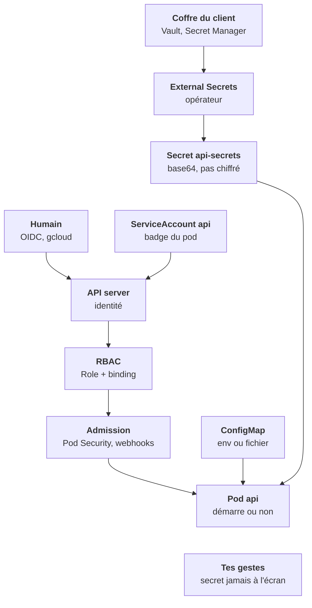
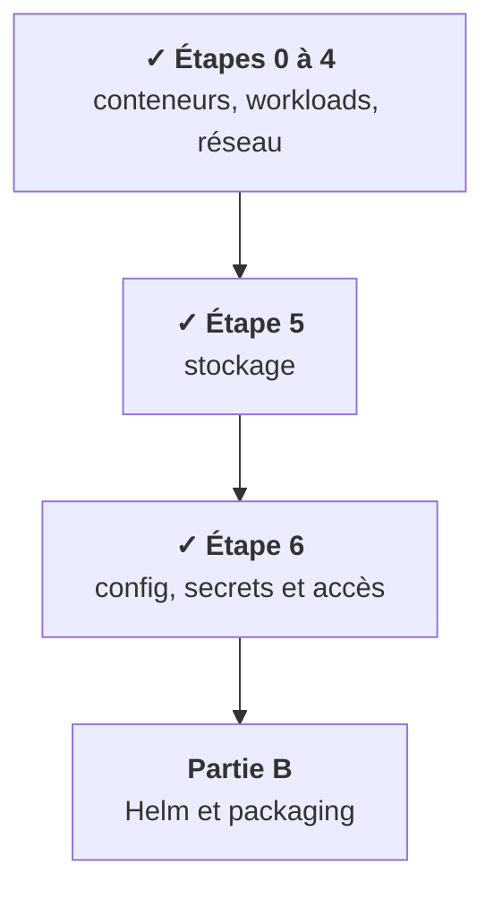

Toute l'étape suit **un pod qui veut démarrer**. Il lui faut sa config et ses secrets, une identité, le droit d'être créé, et la conformité au règlement du cluster. Chaque contrôle peut dire non, et chacun a son symptôme.

Regarde les couleurs : ce qui est **écrit** (violet, ConfigMap, Secret, Role) n'agit que par **ce qui contrôle** (ambre, API server, admission, opérateurs). Lance le pas à pas avec ▶.

## Ce que tu sais faire maintenant

- **Prévoir quand une config est prise en compte**, et exiger le checksum. [Leçon 1](/l/06-config-secrets/01-config-entre-dans-le-pod/)
- **Expliquer ce qui protège un Secret** et demander comment arrivent les secrets. [Leçon 2](/l/06-config-secrets/02-secret-pas-secret/)
- **Dire d'où vient l'identité** d'un humain et d'un pod. [Leçon 3](/l/06-config-secrets/03-qui-es-tu/)
- **Lire un Role et son binding**, et prouver un droit. [Leçon 4](/l/06-config-secrets/04-rbac-tes-droits/)
- **Reconnaître un refus d'admission** et un webhook mutant. [Leçon 5](/l/06-config-secrets/05-admission-pod-security/)
- **Manipuler un secret sans le laisser traîner.** [Leçon 6](/l/06-config-secrets/06-hygiene-secrets-acces/)

## Les mots de l'étape

| Mot | En une phrase | Dans l'immeuble |
|---|---|---|
| ConfigMap | La configuration d'une appli, hors de l'image. | La note de service |
| Secret | Une config sensible, juste encodée en base64. | L'enveloppe pliée |
| Checksum | Le hash de la config qui force le redémarrage. | La note qui oblige à relire |
| External Secrets | L'opérateur qui copie les secrets du coffre. | Le coursier de la banque |
| ServiceAccount | L'identité d'un pod face à l'API. | Le badge d'employé |
| OIDC | L'identité humaine venue de l'annuaire du client. | La carte d'identité |
| Role, ClusterRole | Une liste de droits. | La liste des portes |
| RoleBinding | Donne un rôle à quelqu'un, dans un namespace. | L'accès encodé sur le badge |
| Admission | Le contrôle de chaque objet avant son entrée. | Le vigile à l'entrée |
| Pod Security | Les niveaux privileged, baseline, restricted. | Le règlement de sécurité |
| Webhook mutant | Un contrôle du client qui modifie tes objets. | Le vigile maison qui ajoute un badge |

## Où tu en es dans la partie A

Le socle est posé : où tourne un pod, comment il est joint, où vivent ses données, et qui a le droit de quoi. La partie B passe à l'emballage : comment un chart Helm décrit tout ça, et le livre chez des clients différents.

<Retenir>
Config en variable = figée, en fichier = mise à jour. Un Secret n'est protégé que par le RBAC, et chez un client il vient d'un coffre. RBAC dit qui crée, l'admission dit à quoi ça ressemble : un Deployment à 0/1 sans pod, lis les events.
</Retenir>
