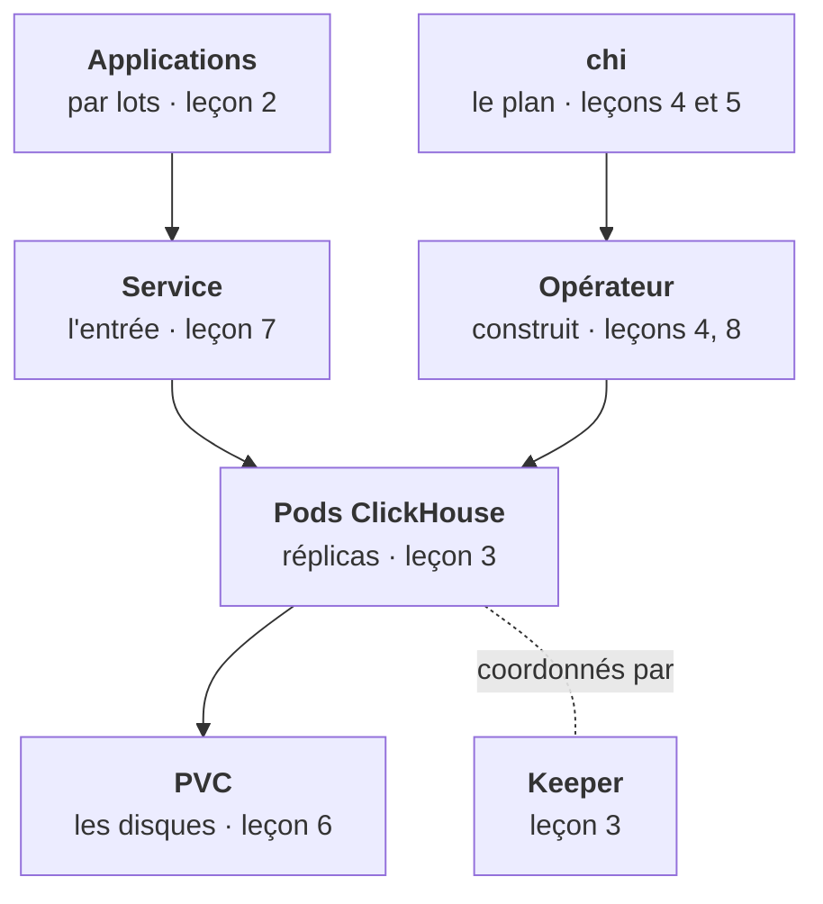
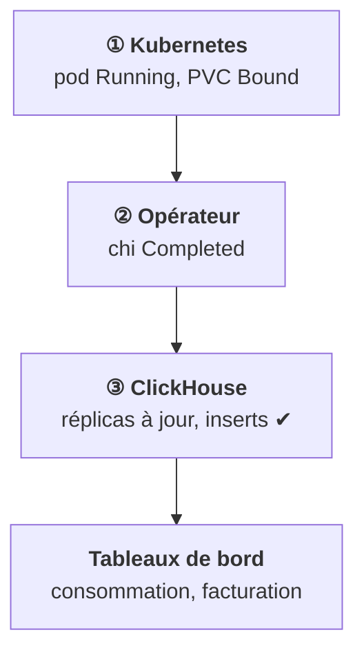

<Idee>
**ClickHouse** est la base analytique de la plateforme : elle range les données par colonne pour additionner très vite des milliards de lignes. Chez un client, tu ne la déploies pas à la main : tu écris un plan, et un **opérateur** la construit.
</Idee>

<Analogie>
Un **entrepôt logistique**. Les marchandises arrivent par **camions pleins**, sont rangées par **rayon**, et on vient y faire des inventaires géants. Toi, tu donnes le **plan de l'architecte** ; un **chef de chantier** construit et entretient. On garde cet entrepôt pendant toute l'étape.
</Analogie>

## La carte de l'étape

Les leçons 9 à 11 couvrent ensuite la vie de l'ensemble : mise à jour, sauvegarde, diagnostic.

## Quatre morceaux

| Morceau | Son rôle |
|---|---|
| Pods ClickHouse | Stockent et interrogent. Un pod, un disque. |
| Keeper | Petit service qui coordonne les réplicas. |
| Opérateur | Lit ton plan, fabrique StatefulSets et Services. |
| PVC | Les disques. La seule chose irremplaçable. |

## Pourquoi « colonnaire » change tout

Une base classique range ligne par ligne : parfait pour retrouver **une** commande. ClickHouse range colonne par colonne : parfait pour répondre à « combien de tokens par organisation, par jour, sur 90 jours ». En échange, on y écrit **par lots**, et modifier une ligne précise coûte cher.

Dans la plateforme, elle reçoit les événements de consommation, les traces et les évaluations.

## Trois étages, trois vérifications

Chaque étage a sa propre idée de « ça marche », et l'étage du dessous ne dit rien de celui du dessus. C'est le fil rouge de l'étape.

<Terrain>
Si ClickHouse tombe, le chat continue de répondre. Ce sont la consommation et la facturation qui s'arrêtent, sans alerte visible côté utilisateur.
</Terrain>

<Piege>
Répondre « tout est vert » après un `kubectl get pods`. Tu n'as vérifié que l'étage 1.
</Piege>

<Retenir>
Quatre morceaux : pods, Keeper, opérateur, disques. Trois étages à vérifier dans l'ordre : Kubernetes, opérateur, ClickHouse. Un pod vert ne prouve pas que les données arrivent.
</Retenir>
