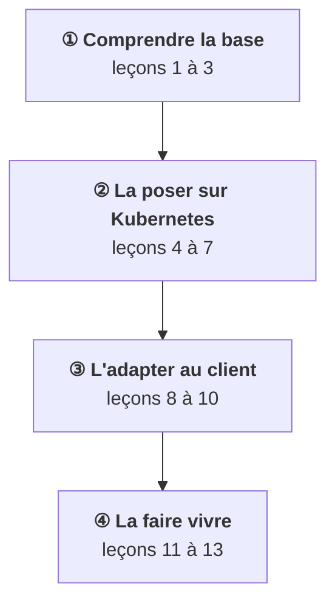
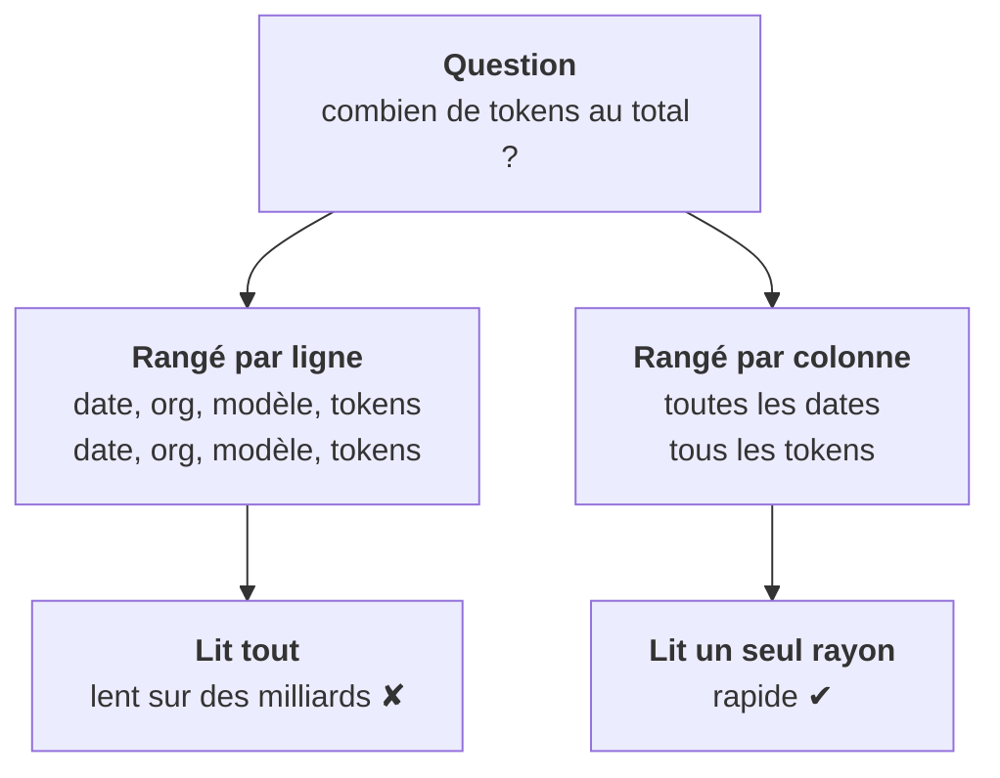

<Idee>
**ClickHouse** est une base de données, comme PostgreSQL, et on lui parle aussi en SQL. Mais elle est faite pour une seule chose : **compter et additionner** très vite sur des milliards de lignes. Pas pour retrouver ou modifier une ligne précise.
</Idee>

<Analogie>
PostgreSQL est un **classeur de bons de commande** : un bon par feuille, parfait pour retrouver la commande de Mme Martin. ClickHouse est un **entrepôt logistique** où tout est rangé par **rayon** : parfait pour un inventaire géant. On garde cet entrepôt pendant toute l'étape.
</Analogie>

## La carte de l'étape

Tu n'as jamais utilisé ClickHouse : on commence donc par la base elle-même, sans Kubernetes.

## Ranger par ligne ou par colonne

Prends des événements de consommation : une date, une organisation, un modèle, un nombre de tokens. La question : « combien de tokens au total ? »

Deuxième avantage : dans un rayon, toutes les valeurs se ressemblent (que des nombres, ou que des noms de modèles). Elles se **compressent** très bien, donc moins de disque à lire.

## Ce qu'on lui demande, ce qu'on ne lui demande pas

| Demande | ClickHouse |
|---|---|
| Tokens par organisation et par jour, sur 90 jours | ✔ son métier |
| Nombre de conversations par modèle ce mois-ci | ✔ son métier |
| Retrouver le profil de l'utilisateur 42 | ✘ métier de PostgreSQL |
| Changer l'e-mail d'un utilisateur | ✘ modifier une ligne coûte cher |
| Débiter un compte et en créditer un autre, ensemble | ✘ pas fait pour les transactions |

<Compare>
<Cas titre="PostgreSQL">

- Rangé par ligne
- Lit et modifie une ligne
- L'état de l'application

</Cas>
<Cas titre="ClickHouse">

- Rangé par colonne
- Agrège des milliards
- L'historique à analyser

</Cas>
</Compare>

Le prix de cette vitesse : on y écrit **par gros paquets**, pas ligne à ligne, et on ne corrige presque jamais ce qui est écrit. La leçon 3 explique pourquoi.

<Terrain>
Dans la plateforme, ClickHouse reçoit les événements de consommation, les traces et les évaluations. Ce sont eux qui alimentent les tableaux de bord et la facturation. PostgreSQL garde le reste.
</Terrain>

<Retenir>
ClickHouse est une base SQL rangée par colonne, faite pour agréger d'énormes volumes. Elle complète PostgreSQL, elle ne le remplace pas.
</Retenir>
