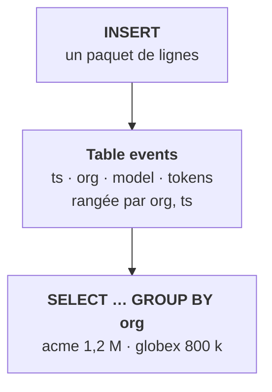

<Idee>
On utilise ClickHouse comme n'importe quelle base SQL : on crée une **table** avec des colonnes typées, on y **insère** des lignes, on l'interroge avec `SELECT`. Deux mots nouveaux seulement : le **moteur** de la table et son **ordre de rangement**.
</Idee>

<Analogie>
Une table est un **hall** de l'entrepôt. Chaque colonne est un **rayon**. Le `ORDER BY` de la table, c'est l'**ordre de rangement** dans les rayons : rangé par organisation puis par date, on va droit à l'allée d'une organisation sans fouiller tout le hall.
</Analogie>



## Créer une table

```sql
CREATE DATABASE analytics;

CREATE TABLE analytics.events (
  ts     DateTime,
  org    String,
  model  String,
  tokens UInt32
)
ENGINE = MergeTree
ORDER BY (org, ts);
```

- **Les types** ressemblent à ceux que tu connais : `String`, `DateTime`, `UInt32` (entier positif), `Float64`.
- **`ENGINE`**, le moteur, dit comment la table stocke ses données. `MergeTree` est le moteur standard ; presque toutes les tables l'utilisent, lui ou une variante.
- **`ORDER BY`** est obligatoire : c'est l'ordre de rangement sur le disque.

## Écrire et lire

```sql
INSERT INTO analytics.events VALUES
  ('2026-11-12 09:00:00', 'acme',   'large'    , 1200),
  ('2026-11-12 09:00:05', 'globex', 'small'    ,  300);

SELECT org, sum(tokens) AS total
FROM analytics.events
WHERE ts >= now() - INTERVAL 7 DAY
GROUP BY org
ORDER BY total DESC;
```

C'est du SQL ordinaire. Ce qui change est dessous.

| Ce que tu fais | Ce qui se passe |
|---|---|
| Filtrer sur `org` | ✔ rapide : c'est le début de l'ordre de rangement |
| Additionner `tokens` | ✔ rapide : une seule colonne lue |
| Insérer deux fois la même ligne | ✘ deux lignes, pas d'erreur |
| `UPDATE` d'une ligne | ✘ possible mais lourd, à éviter |

## Par où on lui parle

- **`clickhouse-client`** : le client en ligne de commande, livré dans l'image. Dans un pod : `kubectl exec`, puis tu tapes ton SQL.
- **HTTP, port 8123** : on envoie la requête dans un appel HTTP. C'est ce qu'utilisent la plupart des applications et des outils de tableaux de bord.
- **Les tables `system`** : ClickHouse décrit son propre état dans des tables qu'on interroge en SQL, comme `system.tables`. On s'en servira pour tout diagnostic.

<Terrain>
Tu n'écriras pas ces tables chez un client : c'est l'application qui les crée. Mais tu dois savoir en lire une, ouvrir un client et compter des lignes pour vérifier que les données arrivent.
</Terrain>

<Piege>
Prendre `ORDER BY` pour une clé primaire à la PostgreSQL. Il ne garantit aucune unicité : un lot rejoué est compté deux fois.
</Piege>

<Retenir>
Une table ClickHouse, c'est des colonnes typées, un moteur (`MergeTree`) et un ordre de rangement (`ORDER BY`). On lui parle en SQL, par `clickhouse-client` ou en HTTP sur le port 8123.
</Retenir>
