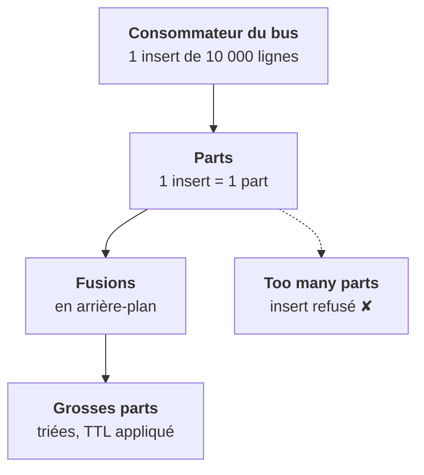

<Idee>
Chaque `INSERT` crée un petit paquet de fichiers, une **part**. ClickHouse fusionne ensuite les parts en arrière-plan. Trop de petits inserts, et il croule sous les parts : on écrit donc **par lots**.
</Idee>

<Analogie>
Chaque insert est une **palette** posée sur le quai. Des **caristes** regroupent les palettes en fond d'entrepôt. Un camion plein, c'est une palette bien remplie. Mille coursiers avec un colis chacun, c'est mille palettes : le quai sature et l'entrepôt **ferme la barrière**.
</Analogie>

## Ce qu'est une part

Tu as vu à la leçon 2 que le moteur standard s'appelle **MergeTree**. Son nom vient de là : il écrit des parts, puis les fusionne (merge). Une part est un répertoire sur le disque, trié selon la clé `ORDER BY` de la table, et qu'on ne modifie plus. Lire une table, c'est lire toutes ses parts actives : moins il y en a, plus c'est rapide.

| Rythme d'écriture | Ce qui se passe |
|---|---|
| 1 insert de 10 000 lignes par seconde | ✔ une part par seconde, les fusions suivent |
| 500 inserts d'une ligne par seconde | ✘ 500 parts par seconde, saturation |
| Partition par jour **et** par client | ✘ des parts partout, même saturation |

Le seuil s'appelle `parts_to_throw_insert` : 3000 parts actives **par partition** par défaut. Le monter ne fait que retarder l'erreur.

## Partitions et TTL

- `PARTITION BY toYYYYMM(ts)` découpe la table par mois : pratique pour retirer un mois d'un coup.
- `TTL ts + INTERVAL 30 DAY` supprime les lignes de plus de 30 jours, pendant les fusions.
- Supprimer ou corriger **une** ligne est une **mutation** : ClickHouse réécrit des parts entières, en différé. À réserver aux cas obligés, comme une demande RGPD.

<Compare>
<Cas ton="ok" titre="Par lots">

- Des milliers de lignes par insert
- Quelques inserts par seconde
- Sinon : `async_insert` côté serveur

</Cas>
<Cas ton="ko" titre="Ligne à ligne">

- Une part par événement
- Requêtes de plus en plus lentes
- Puis `Too many parts`

</Cas>
</Compare>

<Terrain>
Dans la plateforme, ce sont les consommateurs du bus de messages qui accumulent puis écrivent. Un `Too many parts` se corrige chez celui qui écrit, pas dans ton chart.
</Terrain>

<Retenir>
Un insert, une part. On écrit par lots, on partitionne large, et on pose un TTL dès la création de la table, sinon le disque finit plein.
</Retenir>
