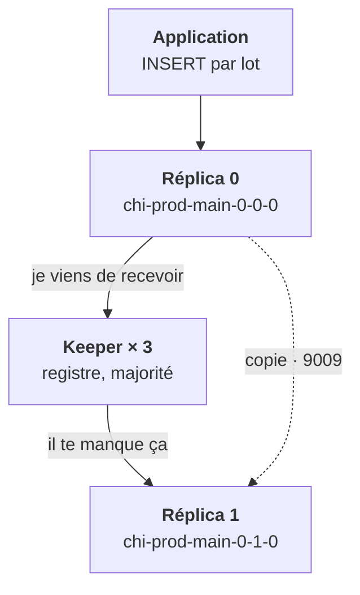

<Idee>
Un **réplica** est une copie complète des données sur un autre pod : il protège d'une panne. Un **shard** est un morceau des données : il ajoute de la capacité. **Keeper** est le petit service qui dit à chaque réplica ce qu'il doit avoir.
</Idee>

<Analogie>
Un réplica, c'est un **entrepôt jumeau** : même stock, autre adresse. Un shard, c'est un **entrepôt régional** : le stock est découpé entre plusieurs sites. Keeper, c'est le **bureau des registres** : trois greffiers notent chaque palette reçue et décident à la majorité.
</Analogie>

## Deux axes à ne pas confondre

| Besoin du client | Réponse |
|---|---|
| Survivre à la perte d'un nœud | ✔ des réplicas |
| Répartir les lectures | ✔ des réplicas |
| Dépasser la capacité d'une machine | ✔ des shards |
| « Plus de sécurité » avec 2 shards | ✘ aucune copie en plus |

Topologie de départ raisonnable : **1 shard, 2 ou 3 réplicas**. On n'ajoute des shards que contraint, parce que redécouper des données existantes n'est pas automatique. Avec plusieurs shards, une table `Distributed` sert de guichet : elle ne stocke rien, elle interroge chaque shard et rassemble.

## La réplication se décide par table

C'est le moteur de la table qui réplique : `ReplicatedMergeTree`. Une table `MergeTree` simple reste sur le pod où on l'a créée, même dans un cluster à trois réplicas.

## Keeper

ClickHouse Keeper remplace ZooKeeper dans ce rôle. Il tient le journal de la réplication et fait passer les requêtes `ON CLUSTER`, celles qui créent une table sur tous les hôtes à la fois.

- **Majorité** : 3 instances tolèrent une perte, 5 en tolèrent deux. Toujours impair, sur des nœuds différents.
- **Disque rapide** : Keeper synchronise chaque écriture sur disque. Un disque lent donne des sessions expirées côté ClickHouse.

<Terrain>
Un client qui veut « économiser » en ne mettant qu'un Keeper retire toute la haute disponibilité en écriture : ce pod seul devient le point de panne de tous les inserts.
</Terrain>

<Piege>
Croire les données répliquées parce que le cluster a deux réplicas. Vérifie le moteur des tables, puis `system.replicas`.
</Piege>

<Retenir>
Réplica pour la disponibilité, shard pour la capacité. La réplication passe par `ReplicatedMergeTree` et par Keeper, à trois instances. Keeper perdu : lecture seule, pas de perte.
</Retenir>
