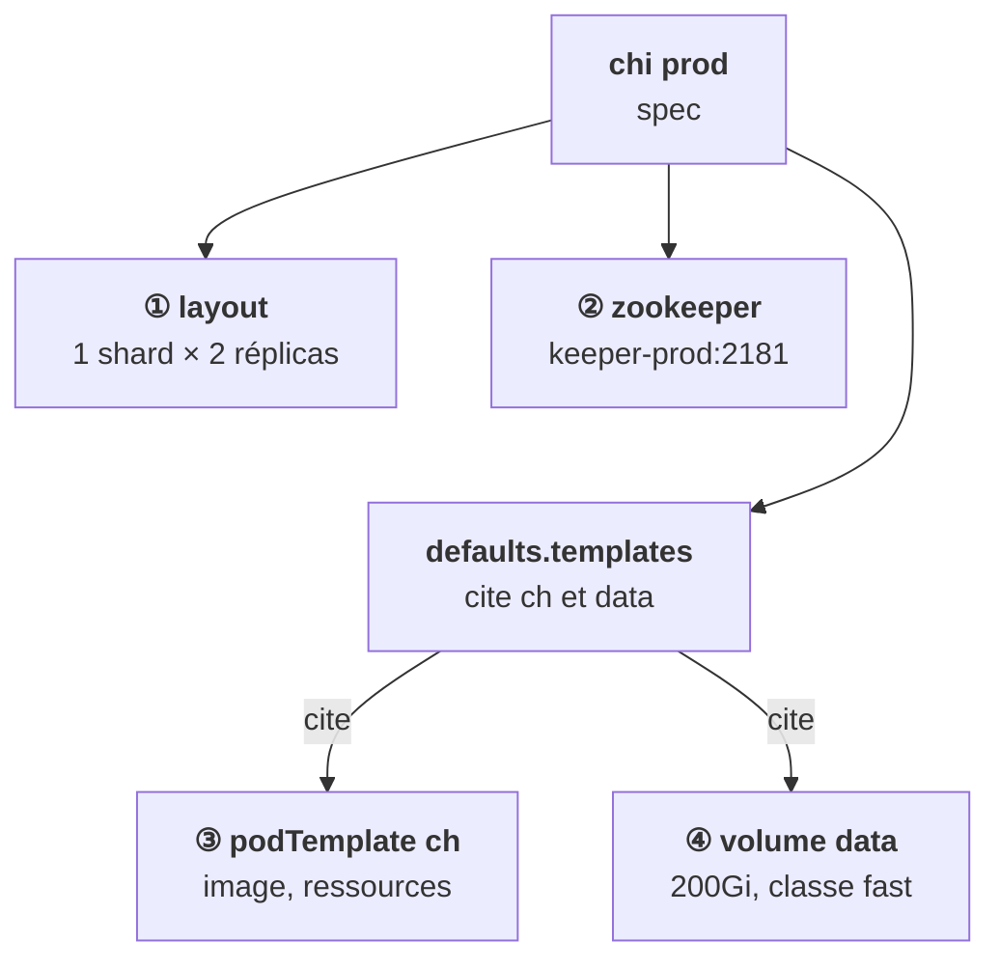

<Idee>
Un `chi` se lit en quatre blocs : **combien** d'hôtes, **où** est Keeper, **à quoi ressemble** un pod, **quel disque** il reçoit. Et une règle : un modèle écrit mais pas référencé n'est pas utilisé.
</Idee>

<Analogie>
Le plan de l'architecte a quatre pages : le **nombre d'entrepôts**, l'adresse du **bureau des registres**, la **fiche type** d'un entrepôt, et les **rayonnages**. Une fiche type glissée dans le dossier mais citée nulle part : le chef de chantier construit le modèle standard.
</Analogie>



## Topologie et Keeper

```yaml
spec:
  configuration:
    zookeeper:
      nodes:
        - host: keeper-prod
          port: 2181
    clusters:
      - name: main
        layout:
          shardsCount: 1
          replicasCount: 2
  defaults:
    templates:
      podTemplate: ch
      dataVolumeClaimTemplate: data
```

- `layout` : shards fois réplicas donne le nombre de pods.
- `zookeeper` : l'adresse de Keeper, hôte et port. Depuis l'opérateur 0.27, on peut référencer directement une installation Keeper par son nom (`zookeeper.keeper.name`).
- `defaults.templates` : **quels** modèles s'appliquent à tous les hôtes.

## Pod et disque

```yaml
  templates:
    podTemplates:
      - name: ch
        spec:
          containers:
            - name: clickhouse
              image: registry.client.example/clickhouse/clickhouse-server:25.8
    volumeClaimTemplates:
      - name: data
        reclaimPolicy: Retain
        spec:
          storageClassName: fast
          accessModes: [ReadWriteOnce]
          resources:
            requests:
              storage: 200Gi
```

Un `podTemplate` contient un `spec` de pod ordinaire : image, `resources`, affinité, tolerations, `securityContext`. Tout ce que tu sais d'un pod s'y applique.

## La référence, sinon rien

| Ce que tu écris | Ce qui se passe |
|---|---|
| Template `ch` défini **et** cité dans `defaults.templates` | ✔ image du client, tes ressources |
| Template `ch` défini, pas cité | ✘ image par défaut de l'opérateur |
| `volumeClaimTemplates` défini, pas cité | ✘ pas de disque persistant |
| Nom cité qui n'existe pas | ✘ même effet : le modèle n'est pas trouvé |

Keeper se déclare sur le même modèle : `kind: ClickHouseKeeperInstallation`, avec `replicasCount: 3`.

<Terrain>
Dans ton chart parapluie, le `chi` est un template Helm. Les valeurs à exposer par client : registry et tag de l'image, `storageClassName`, taille du disque, `replicasCount`, ressources.
</Terrain>

<Piege>
Un champ mal placé peut disparaître sans erreur, comme à l'étape 9. Après l'application, relis toujours `kubectl get chi -o yaml` : c'est la vérité.
</Piege>

<Retenir>
Quatre blocs : `layout`, `zookeeper`, `podTemplates`, `volumeClaimTemplates`. Un modèle ne s'applique que s'il est cité dans `defaults.templates`. Vérifie le rendu, pas ton intention.
</Retenir>
