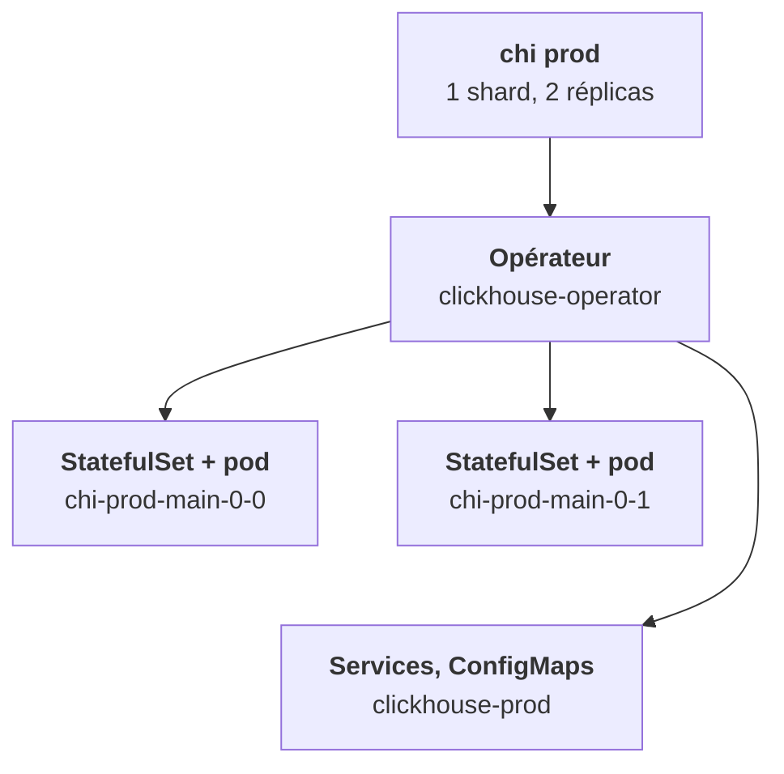

<Idee>
Tu écris une seule ressource, le **ClickHouseInstallation** (`chi`). L'**opérateur**, un programme qui tourne dans le cluster, la lit et fabrique tout le reste : StatefulSets, Services, ConfigMaps, disques. Tu ne touches qu'au plan.
</Idee>

<Analogie>
Le `chi` est le **plan de l'architecte** : « un site, deux entrepôts jumeaux, des rayonnages de 200 Gi ». L'opérateur est le **chef de chantier** : il construit, puis repasse sans cesse comparer le bâtiment au plan. Si tu déplaces une cloison toi-même, il la remet.
</Analogie>

## Ce qu'il fabrique

Pour le `chi` `prod`, cluster `main`, 1 shard et 2 réplicas :

| Objet | Nom |
|---|---|
| StatefulSets | `chi-prod-main-0-0` et `chi-prod-main-0-1` |
| Pods | `chi-prod-main-0-0-0` et `chi-prod-main-0-1-0` |
| Services par hôte | mêmes noms que les StatefulSets, ports 8123, 9000, 9009 |
| Service d'entrée | `clickhouse-prod` |
| ConfigMaps | `chi-prod-common-configd`, `chi-prod-common-usersd`, un par hôte |
| PVC | un par hôte et par volume déclaré |

Le dernier `-0` du nom de pod vient du StatefulSet : chaque hôte a le sien, avec un seul pod.

## Pourquoi un opérateur

La configuration d'un cluster ClickHouse dit qui est réplica de qui, où est Keeper, et quel nom porte chaque hôte. Elle change dès qu'on ajoute un réplica. L'opérateur la génère et la tient à jour ; un StatefulSet écrit à la main ne le ferait pas.

## Deux opérateurs existent

<Compare>
<Cas titre="Altinity">

- `ClickHouseInstallation`
- API `clickhouse.altinity.com/v1`
- Très répandu, mûr

</Cas>
<Cas titre="Officiel ClickHouse">

- `ClickHouseCluster`
- API `clickhouse.com/v1alpha1`
- Récent, exige cert-manager

</Cas>
</Compare>

Cette étape suit l'opérateur **Altinity**. Les idées se transposent à l'autre, les noms de champs non.

<Terrain>
Le statut du `chi` est ton étage 2 : `InProgress` pendant que l'opérateur travaille, `Completed` quand le bâtiment est conforme, `Aborted` si la réconciliation s'est interrompue.
</Terrain>

<Piege>
`kubectl edit` ou `kubectl scale` sur un StatefulSet `chi-…`. Le changement est défait, ou laisse l'opérateur perdu. Tout passe par le `chi`.
</Piege>

<Retenir>
Tu écris le `chi`, l'opérateur fabrique un StatefulSet par hôte, les Services et la configuration. On modifie le plan, jamais le bâtiment.
</Retenir>
