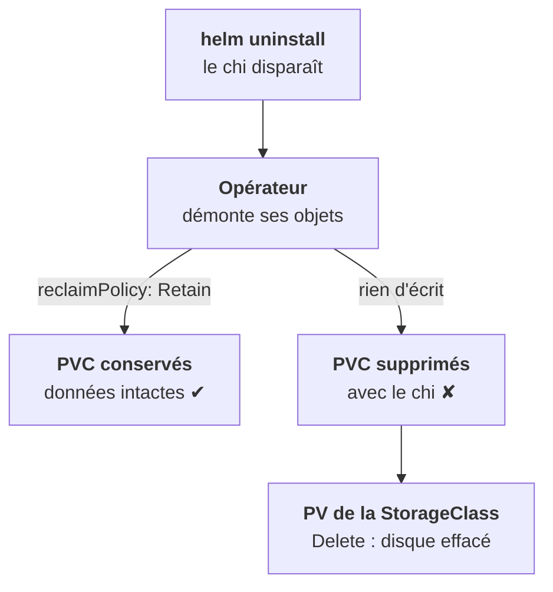

<Idee>
Trois réglages tiennent la base debout : un **disque** qui survit à la suppression du plan, une **mémoire** fixée pour que le pod ne soit pas tué, et un **placement** qui sépare les copies sur des nœuds différents.
</Idee>

<Analogie>
Les PVC sont le **terrain et les rayonnages** : on peut reconstruire un bâtiment, pas le stock. La mémoire, c'est la **surface du quai** : trop petite, une grosse opération est refusée. Et deux entrepôts jumeaux **dans la même rue** brûlent ensemble.
</Analogie>

## Le disque

- **La StorageClass du client**, jamais supposée : du bloc `ReadWriteOnce`, rapide. Pas de NFS pour ClickHouse ni pour Keeper.
- **`reclaimPolicy: Retain`** dans le `volumeClaimTemplate` du `chi`. À ne pas confondre avec la reclaim policy du **PV**, celle de la StorageClass, qui joue après.
- **Agrandir** : on change la taille dans le `chi`. Cela ne marche que si la classe a `allowVolumeExpansion: true`. À essayer en preview avant de le promettre.

## La mémoire

ClickHouse lit la limite de son conteneur et se borne à une fraction, 90 % par défaut (`max_server_memory_usage_to_ram_ratio`).

| Ce que tu vois | Ce que ça veut dire |
|---|---|
| `Memory limit exceeded`, code 241 | ✔ la requête est tuée, le pod vit |
| `OOMKilled`, exit 137 | ✘ le pod est tué : limite trop basse pour la charge |

Mets **requests égales aux limits en mémoire** : c'est la QoS Guaranteed de l'étape 3, celle d'une base. Évite une limite CPU serrée : les fusions prendraient du retard.

## Le placement

<Compare>
<Cas ton="ok" titre="Séparés">

- Anti-affinité entre réplicas
- 3 Keeper sur 3 nœuds
- Un PodDisruptionBudget

</Cas>
<Cas ton="ko" titre="Entassés">

- 2 réplicas, même nœud
- Un drain coupe tout
- Keeper sans majorité

</Cas>
</Compare>

En cloud multi-zone, un disque bloc est collé à sa zone : le pod ne peut renaître que là. Répartis donc les réplicas entre les zones.

<Terrain>
Un client à trois nœuds peut porter 3 Keeper et 2 réplicas séparés. À deux nœuds, la majorité de Keeper ne survit pas à la perte du nœud qui en héberge deux : dis-le avant, pas après.
</Terrain>

<Retenir>
`reclaimPolicy: Retain` dans le `chi`, sinon supprimer le plan supprime les disques. Mémoire en requests égales aux limits. Réplicas et Keeper sur des nœuds différents.
</Retenir>
