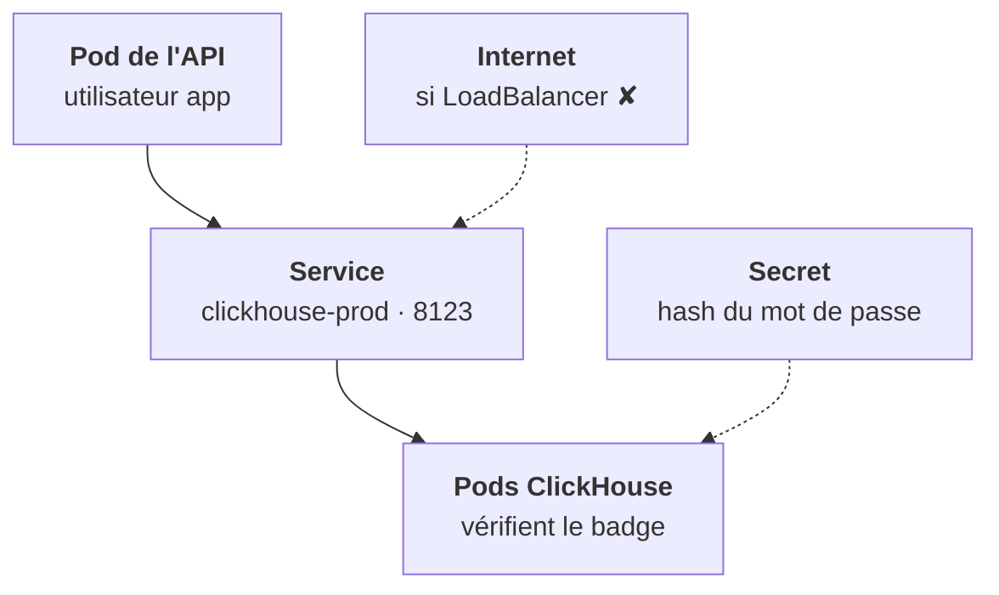

<Idee>
Les applications entrent par **un Service** et avec **leur propre utilisateur**. Deux réglages par défaut surprennent : le Service d'entrée est un **LoadBalancer**, et l'utilisateur `default` ne marche que depuis les pods ClickHouse.
</Idee>

<Analogie>
L'entrepôt a un **quai d'accueil** (le Service) et des **badges** (les utilisateurs). Par défaut, le chef de chantier ouvre un **portail sur la rue** : à refermer. Le badge `default` est un **passe de service** : il n'ouvre que d'un entrepôt à son jumeau.
</Analogie>



## Les ports

| Port | Pour qui |
|---|---|
| 8123 | HTTP : SDK, outils de BI |
| 9000 | Protocole natif : `clickhouse-client` |
| 9009 | Réplication entre réplicas, jamais pour les applications |
| 8443, 9440 | Les variantes TLS de 8123 et 9000 |

## Le Service d'entrée

L'opérateur crée `clickhouse-prod` en **LoadBalancer**. Sur un cloud, cela peut donner une IP externe à la base. On-prem sans MetalLB, il reste en `pending`, comme à l'étape 4. Pour une base interne, déclare un `serviceTemplate` de type `ClusterIP`.

Les applications appellent `clickhouse-prod.<ns>.svc.cluster.local:8123`.

## Les utilisateurs

```yaml
spec:
  configuration:
    users:
      app/password_sha256_hex:
        valueFrom:
          secretKeyRef:
            name: clickhouse-app
            key: password_sha256
      app/networks/ip: "10.244.0.0/16"
      app/profile: default
```

| Qui se connecte | Résultat |
|---|---|
| `app` depuis un pod du cluster | ✔ accepté |
| `default` depuis le pod ClickHouse | ✔ accepté |
| `default` depuis le pod de l'API | ✘ refusé |
| `app` depuis une IP hors de `networks/ip` | ✘ refusé |

Un utilisateur par application, avec le profil qui lui convient : `readonly` pour un outil de BI.

<Terrain>
Le pod CIDR change chez chaque client (étape 4) : la plage de `networks/ip` est une valeur de chart, pas une constante. Une NetworkPolicy complète l'isolation, si le CNI du client l'applique.
</Terrain>

<Piege>
Tester depuis le pod ClickHouse avec `default`, voir que ça marche, et conclure que l'application passera. Teste depuis un pod applicatif, avec son utilisateur.
</Piege>

<Retenir>
Service d'entrée en `ClusterIP`, port 8123 pour le HTTP. Un utilisateur par application, mot de passe dans un Secret. `default` reste le passe interne des réplicas.
</Retenir>
