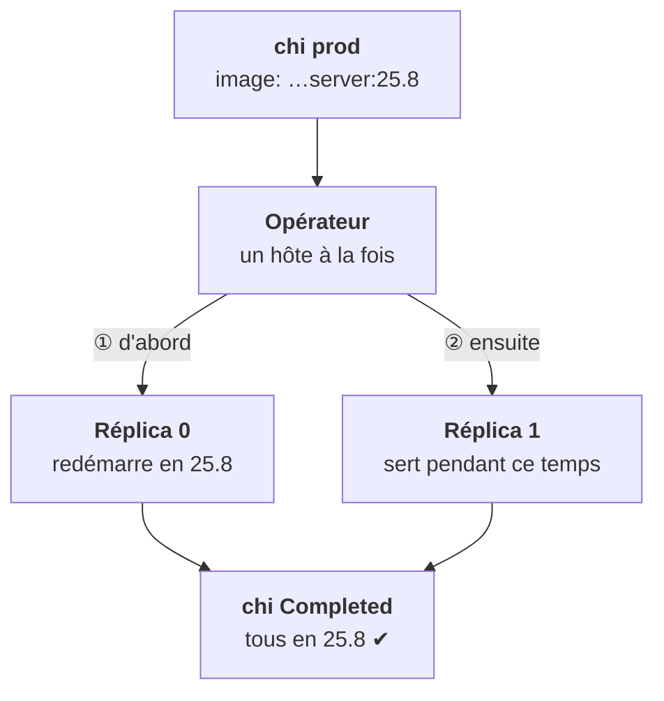

<Idee>
Pour changer de version, tu modifies **une ligne du plan** : le tag de l'image. L'opérateur redémarre alors les hôtes **un par un**, en attendant chacun. Avec deux réplicas, la base reste disponible.
</Idee>

<Analogie>
On rénove les entrepôts jumeaux **l'un après l'autre** : pendant que le premier est fermé, le second sert les clients. Le chef de chantier ne ferme le second que quand le premier a rouvert. Si le matériau n'est pas livré, il s'arrête au premier.
</Analogie>

## Avant de toucher au tag

- **Pousse l'image** dans le registry du client d'abord.
- **Sauvegarde** : revenir en arrière d'une version majeure n'est pas garanti.
- **Essaie en preview** avec une copie du schéma, et monte de version progressivement.

## Les opérations courantes

| Tu veux | Tu fais | Effet |
|---|---|---|
| Changer de version | tag de l'image dans le `podTemplate` | ✔ redémarrage hôte par hôte |
| Ajouter un réplica | augmenter `replicasCount` | ✔ pod, disque et schéma créés, les tables répliquées se remplissent seules |
| Tout arrêter | `spec.stop: "yes"` | ✔ pods arrêtés, PVC et ressource gardés |
| Retirer un shard | à préparer : déplacer ses données avant | ✘ jamais à l'improviste |

Changer un réglage (`settings`, `profiles`, `users`) régénère les ConfigMaps. Selon le réglage, ClickHouse le recharge à chaud ou l'opérateur redémarre les hôtes.

<Compare>
<Cas ton="ok" titre="2 réplicas ou plus">

- Un hôte redémarre
- L'autre sert
- Pas de coupure

</Cas>
<Cas ton="ko" titre="1 seul réplica">

- Le seul hôte redémarre
- Personne ne sert
- Coupure à annoncer

</Cas>
</Compare>

## Mettre à jour l'opérateur lui-même

Une version mineure à la fois : sauter plusieurs mineures n'est pas supporté. Lis les notes de version, mets les CRDs à jour d'abord (étape 9). Une mise à jour de l'opérateur peut déclencher une réconciliation, donc un redémarrage roulant des hôtes : choisis ton moment.

<Terrain>
En air-gapped, la mise à jour commence la veille : transfert des images, puis vérification qu'elles sont bien tirables depuis un nœud du client.
</Terrain>

<Retenir>
On change le tag dans le `chi`, l'opérateur fait le reste, hôte par hôte. Image poussée et sauvegarde faite avant. Arrêt par `stop`, jamais par `scale`.
</Retenir>
