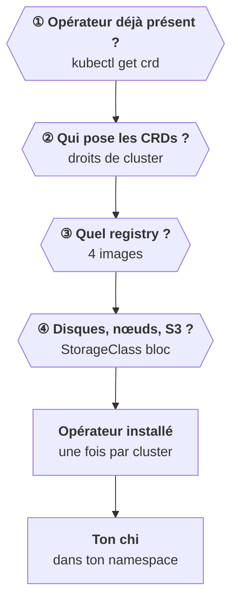

<Idee>
L'**opérateur** s'installe une fois par cluster et touche à des objets que seul un administrateur peut créer. Avant d'écrire le moindre `chi`, tu poses donc quelques questions au client : droits, registry, disques, nœuds.
</Idee>

<Analogie>
Avant d'envoyer le chef de chantier, on vérifie le **permis de construire** (les droits de cluster), le **fournisseur de matériaux** autorisé sur le site (le registry), la **nature du terrain** (la StorageClass), et s'il n'y a pas **déjà un chef de chantier** sur place.
</Analogie>

## Ce que l'installation pose dans le cluster

- **4 CRDs** : `clickhouseinstallations`, `clickhouseinstallationtemplates`, `clickhouseoperatorconfigurations` et `clickhousekeeperinstallations`.
- Un ServiceAccount, un ClusterRole et son binding.
- Le Deployment `clickhouse-operator`, à deux conteneurs : l'opérateur et un exporteur de métriques (port 8888).

Le manifeste par défaut l'installe dans `kube-system`, d'où il surveille **tous** les namespaces. Il existe aussi un chart Helm, `altinity-clickhouse-operator`.

## Les questions, dans l'ordre

| Question | Ce qui casse sinon |
|---|---|
| Un opérateur ClickHouse est-il déjà là ? | ✘ deux opérateurs se battent |
| Qui installe les CRDs ? | ✘ `forbidden` à l'installation |
| Quel registry, quel secret de pull ? | ✘ `ImagePullBackOff` |
| Quelle StorageClass bloc ? | ✘ PVC `Pending` |
| Combien de nœuds et de zones ? | ✘ pods `Pending`, anti-affinité impossible |
| Un S3 pour les sauvegardes ? | ✘ pas de sauvegarde hors cluster |
| UID imposé, Pod Security ? | ✘ `permission denied` sur le volume |

Les quatre images : `clickhouse-server`, `clickhouse-keeper`, `clickhouse-operator` et `metrics-exporter`.

## Les CRDs et Helm

Le chart de l'opérateur installe **et met à jour** ses CRDs par un hook (`crdHook.enabled`). C'est l'inverse du comportement Helm standard de l'étape 9. Si le client gère les CRDs lui-même, désactive ce hook et livre-lui les fichiers.

<Terrain>
Sur OpenShift, le conteneur ClickHouse tourne par défaut avec l'UID 101 et un `fsGroup`. À vérifier pour la distribution du client avant le jour de l'installation.
</Terrain>

<Piege>
Une CRD plus ancienne que ton `chi` : les champs qu'elle ne connaît pas disparaissent sans erreur. Compare la version de l'opérateur en place avec celle que ton chart attend.
</Piege>

<Retenir>
Avant tout : opérateur déjà présent, droits sur les CRDs, registry pour quatre images, StorageClass bloc, nombre de nœuds, S3. L'opérateur d'abord, le `chi` ensuite.
</Retenir>
