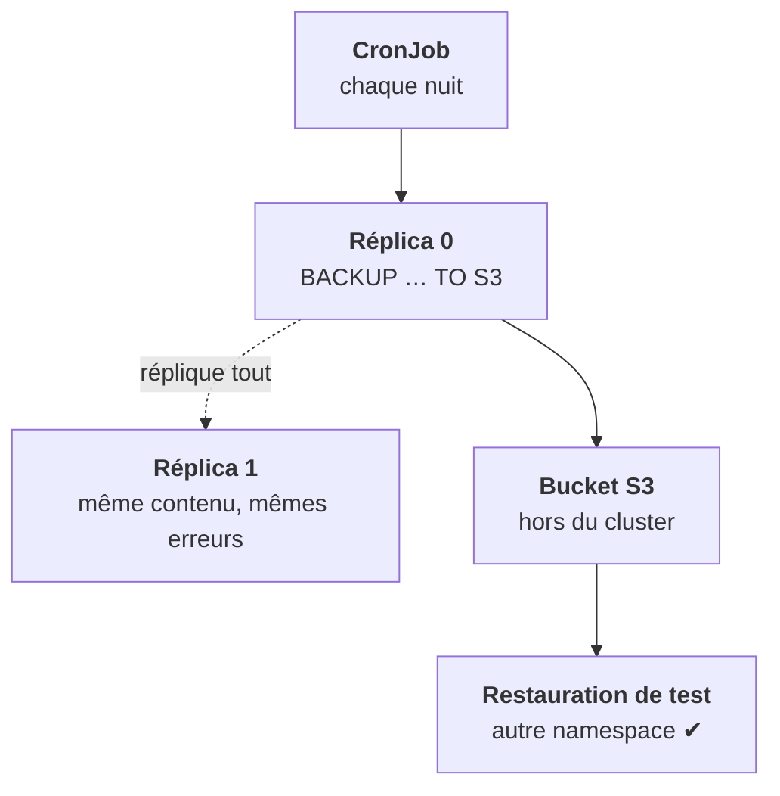

<Idee>
La réplication recopie tout, **y compris les erreurs** : un `DROP TABLE` arrive sur tous les réplicas en quelques secondes. Une vraie sauvegarde part **hors du cluster**, vers un stockage objet, et ne compte que si on a réussi à la restaurer.
</Idee>

<Analogie>
L'entrepôt jumeau reçoit les mêmes ordres que l'original : si on ordonne de **vider un rayon**, les deux le vident. La sauvegarde, c'est un **garde-meuble dans une autre ville**, où l'on envoie régulièrement une copie du stock. Et on y retourne vérifier qu'on sait la ressortir.
</Analogie>

## Ce que couvre chaque protection

| Incident | Réplicas | Sauvegarde |
|---|---|---|
| Un nœud tombe | ✔ | inutile |
| Un disque est perdu | ✔ | inutile |
| `DROP TABLE` par erreur | ✘ | ✔ |
| Mutation qui abîme les données | ✘ | ✔ |
| Namespace supprimé, PVC compris | ✘ | ✔ |

## Deux mécanismes

<Compare>
<Cas titre="BACKUP natif">

- Commande SQL
- Vers S3 directement
- Suivi : `system.backups`
- À planifier toi-même

</Cas>
<Cas titre="clickhouse-backup">

- Outil Altinity séparé
- Souvent à côté du pod
- Rétention, incrémental
- S3, GCS, Azure

</Cas>
</Compare>

Dans les deux cas, la destination est un stockage objet **hors du cluster**. En air-gapped, c'est le S3 du client (MinIO, Ceph), demandé à la leçon 8. Avec des tables répliquées, sauvegarder **un** réplica par shard suffit.

## Trois preuves, sinon rien

1. **Configurée** : le CronJob existe, sa dernière exécution a réussi.
2. **Présente** : les objets sont dans le bucket, récents, de taille plausible.
3. **Restaurable** : une restauration ailleurs, puis un comptage comparé à la production.

C'est la règle de l'étape 17 pour PostgreSQL, appliquée ici.

<Terrain>
« C'est de l'analytique, pas besoin de sauvegarde » : cette base porte la consommation, donc la **facturation**. La décision appartient au client, mais elle doit être dite, pas héritée d'un oubli.
</Terrain>

<Piege>
Mettre les identifiants S3 en clair dans la commande du CronJob. Ils vont dans un Secret, comme à l'étape 6.
</Piege>

<Retenir>
Les réplicas protègent d'une panne, pas d'une erreur. Une sauvegarde vit hors du cluster et se prouve en trois temps : configurée, présente, restaurée.
</Retenir>
