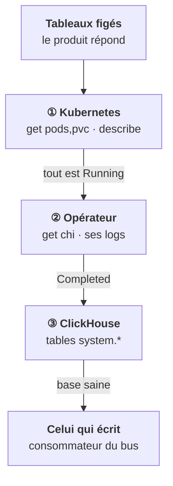

<Idee>
Un incident ClickHouse se remonte toujours dans le même ordre : le **pod** tourne-t-il, l'**opérateur** a-t-il fini, la **base** accepte-t-elle les données ? S'arrêter au premier étage est l'erreur classique.
</Idee>

<Analogie>
On inspecte l'entrepôt en trois temps : le **bâtiment** est-il debout, le **chef de chantier** a-t-il rendu les clés, les **camions** sont-ils vraiment déchargés ? Un bâtiment intact avec la barrière baissée ne reçoit rien.
</Analogie>

## Les symptômes, par étage

| Symptôme | Étage | Cause probable |
|---|---|---|
| Pod `Pending` | ① | PVC non lié, anti-affinité impossible |
| `ImagePullBackOff` | ① | image absente du registry du client |
| `OOMKilled`, exit 137 | ① | limite mémoire trop basse |
| `chi` bloqué `InProgress` | ② | un hôte ne revient pas `Ready` |
| Champ du `chi` sans effet | ② | template non cité, CRD trop ancienne |
| `Table is in readonly mode` | ③ | Keeper injoignable ou sans majorité |
| `Too many parts` | ③ | inserts trop petits, trop fréquents |
| `Memory limit exceeded` (241) | ③ | requête trop lourde |
| Réplica en retard | ③ | port 9009, disque lent |
| `ON CLUSTER` sans fin | ③ | un hôte arrêté, Keeper lent |

## Deux erreurs mémoire, deux étages

<Compare>
<Cas titre="Code 241">

- Vient de ClickHouse
- La requête est tuée
- Le pod continue
- Revoir la requête

</Cas>
<Cas titre="Exit 137">

- Vient du noyau
- Le pod est tué
- Il redémarre
- Revoir la limite

</Cas>
</Compare>

## Le disque plein, à cheval sur deux étages

Sans TTL, le disque se remplit lentement. ClickHouse ne peut alors plus fusionner ni insérer. `system.disks` donne l'espace libre vu par la base ; le PVC s'agrandit dans le `chi`, si la StorageClass le permet.

<Terrain>
Quand le client dit « ClickHouse est cassé », la base est souvent saine et c'est l'écriture qui s'est arrêtée en amont. Après l'étage 3, regarde le retard des consommateurs du bus.
</Terrain>

<Piege>
Redémarrer les pods « pour voir ». Un réplica qui redémarre doit rattraper son retard, et tu perds l'état qui expliquait la panne.
</Piege>

<Retenir>
Pod, opérateur, base, dans cet ordre, puis celui qui écrit. `readonly` pointe vers Keeper, `Too many parts` vers l'application, 137 vers la limite du pod, 241 vers la requête.
</Retenir>
