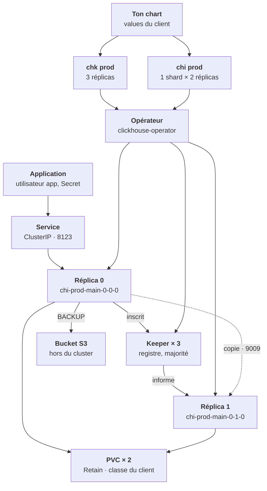
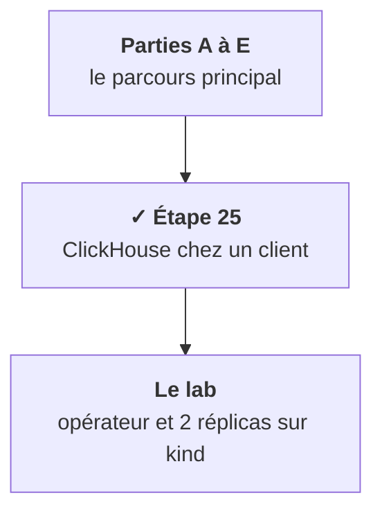

Toute l'étape tient en une phrase : tu écris **un plan**, un opérateur **construit**, et ClickHouse avec Keeper **garde les données cohérentes**. Trois acteurs, trois étages.

Le fil rouge, ce sont ces **trois étages** : un pod `Running` (Kubernetes), un `chi` `Completed` (opérateur), des réplicas à jour qui acceptent les inserts (ClickHouse). Chaque étage peut être vert pendant que celui du dessus est cassé. Regarde les couleurs : le violet est ce que tu écris, l'ambre ce qui travaille pour toi, le vert ce qui porte les données. Lance le pas à pas avec ▶, ou avance avec ›.

## Ce que tu sais faire maintenant

- **Situer les quatre morceaux** et les trois étages à vérifier. [Leçon 1](/l/25-clickhouse/01-carte-clickhouse/)
- **Expliquer parts et fusions**, et pourquoi on écrit par lots. [Leçon 2](/l/25-clickhouse/02-parts-inserts-lots/)
- **Distinguer shard et réplica**, et dire ce que fait Keeper. [Leçon 3](/l/25-clickhouse/03-shards-replicas-keeper/)
- **Nommer ce que l'opérateur fabrique** et n'y pas toucher. [Leçon 4](/l/25-clickhouse/04-operateur-fabrique/)
- **Lire un `chi`** en quatre blocs. [Leçon 5](/l/25-clickhouse/05-lire-un-chi/)
- **Régler disques, mémoire et placement.** [Leçon 6](/l/25-clickhouse/06-stockage-memoire-placement/)
- **Ouvrir l'accès** par le bon Service et le bon utilisateur. [Leçon 7](/l/25-clickhouse/07-acces-services-utilisateurs/)
- **Poser les bonnes questions** au client avant d'installer. [Leçon 8](/l/25-clickhouse/08-preparer-chez-le-client/)
- **Mettre à jour** un hôte à la fois. [Leçon 9](/l/25-clickhouse/09-mettre-a-jour-operer/)
- **Sauvegarder et le prouver.** [Leçon 10](/l/25-clickhouse/10-sauvegarder-prouver/)
- **Diagnostiquer** dans l'ordre pod, opérateur, base. [Leçon 11](/l/25-clickhouse/11-diagnostiquer-trois-etages/)

## Les mots de l'étape

| Mot | En une phrase | Dans l'entrepôt |
|---|---|---|
| Colonnaire | Rangé par colonne, pour agréger vite. | Rangé par rayon |
| Part | Le paquet de fichiers créé par un insert. | Une palette |
| Fusion (merge) | Le regroupement des parts en arrière-plan. | Les caristes |
| TTL | La durée après laquelle les lignes sont supprimées. | La date de péremption |
| Réplica | Une copie complète sur un autre pod. | L'entrepôt jumeau |
| Shard | Un morceau des données. | L'entrepôt régional |
| Keeper | Le service qui coordonne les réplicas, à la majorité. | Le bureau des registres |
| Opérateur | Le programme qui construit d'après ta ressource. | Le chef de chantier |
| `chi` | Le ClickHouseInstallation, ta ressource. | Le plan de l'architecte |
| `chk` | Le ClickHouseKeeperInstallation. | Le plan du bureau des registres |
| PVC | Le disque de chaque hôte. | Le terrain et les rayonnages |
| Service d'entrée | L'adresse stable des applications. | Le quai d'accueil |
| `default` | L'utilisateur interne des réplicas. | Le passe de service |
| Sauvegarde | Une copie hors du cluster, restaurée pour preuve. | Le garde-meuble d'une autre ville |

## Où tu en es dans la partie F

Cette étape est un cas pratique, hors du parcours principal : elle applique à une brique précise le stockage de l'étape 5, les opérateurs de l'étape 9 et le plan de données de l'étape 17. Le lab te fait monter le tout sur ton cluster kind avant de le faire chez le client.

<Retenir>
Tu écris un `chi`, l'opérateur construit, Keeper coordonne. On modifie le plan, jamais les objets fabriqués. Et on vérifie trois étages dans l'ordre : pod, opérateur, base, parce qu'un pod vert ne prouve pas que les données arrivent.
</Retenir>
