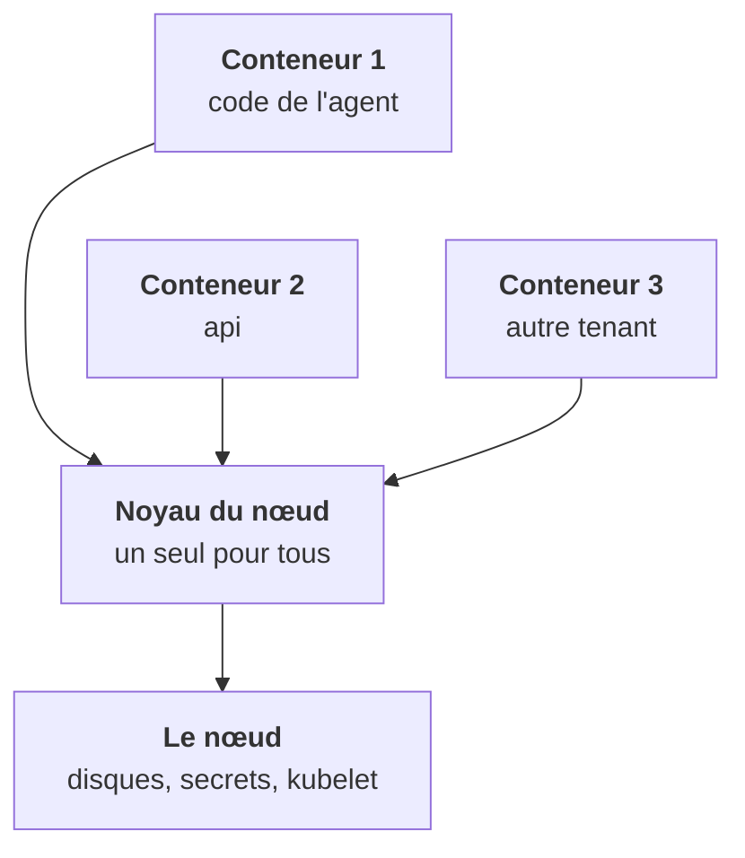

<Idee>
Un conteneur est un **processus ordinaire** du serveur, à qui le noyau cache le reste et retire des droits. Il ne voit que lui, mais il parle au **même noyau** que tous les autres. Une VM, elle, a son propre noyau.
</Idee>

<Analogie>
Dans l'immeuble, chaque **appartement** a ses murs (ce qu'on voit), ses **compteurs** (ce qu'on consomme) et un **règlement** qui interdit certains robinets. Mais la **plomberie** est commune : une fuite dans la colonne inonde tous les étages.
</Analogie>

## Quatre mécanismes, un noyau

| Mécanisme | Ce qu'il règle | Dans l'immeuble |
|---|---|---|
| Namespaces | Ce que le processus **voit** | Les murs |
| cgroups | Ce qu'il **consomme** | Les compteurs |
| seccomp, capabilities | Ce qu'il peut **demander** au noyau | Le règlement des robinets |

## Ce qui est isolé, ce qui ne l'est pas

| Cas | Conteneur runc |
|---|---|
| Voir les processus d'un voisin | ✔ isolé (namespaces) |
| Prendre toute la mémoire du nœud | ✔ isolé (cgroups) |
| Appels système rares et dangereux | ✔ en partie bloqués (seccomp) |
| Une faille du noyau | ✘ le noyau est partagé |
| Une faille du runtime `runc` (il y en a eu) | ✘ accès au nœud |

<Compare>
<Cas titre="Conteneur">

- Un processus du nœud
- Noyau partagé
- Démarrage immédiat

</Cas>
<Cas titre="Machine virtuelle">

- Un système complet
- Son propre noyau
- Plus lourde

</Cas>
</Compare>

<Piege>
Croire qu'un `docker run` est aussi étanche qu'une VM. C'est assez pour ton application, que tu connais. Pas pour du code qu'un attaquant peut choisir.
</Piege>

<Retenir>
Une faille du noyau touche tous les conteneurs du nœud. Face à du code hostile, les murs d'un conteneur ne suffisent pas : il faut changer de mur.
</Retenir>
