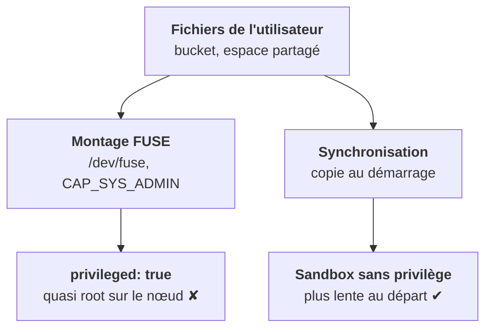

<Idee>
`privileged: true` rend au conteneur presque tous les droits sur le serveur : tous les périphériques, les montages, aucun filtre. **FUSE**, qui monte des fichiers distants comme un dossier, le demande souvent. Sans privilège, on **synchronise** les fichiers à la place.
</Idee>

<Analogie>
Le mode privilégié, c'est donner à l'inconnu les **clés du local technique** : compteurs, colonnes, tableau électrique. FUSE, c'est un **branchement direct sur la colonne** pour faire arriver ses cartons. La synchronisation, c'est **livrer les cartons par la porte** : plus lent, sans clé.
</Analogie>

## Ce que `privileged: true` ouvre

- **Toutes les capabilities**, dont `CAP_SYS_ADMIN`.
- **Tous les devices** du nœud : le `/dev` complet, disques compris.
- Les **montages**, avec seccomp et AppArmor ou SELinux relâchés.

Avec ça, on monte le disque du nœud et on le modifie. Les murs de la leçon 2 tombent.

<Compare>
<Cas ton="ko" titre="Montage FUSE">

- Fichiers à la demande
- Rapide à l'usage
- Privilège requis

</Cas>
<Cas ton="ok" titre="Synchronisation">

- Copie au démarrage
- Plus lente au départ
- Aucun privilège

</Cas>
</Compare>

Avec gVisor ou Kata (leçon 5), le privilège s'applique à l'intérieur du nouveau mur, pas au noyau du nœud : le risque change de nature. Ce que chaque runtime accepte pour FUSE dépend de sa version : à vérifier.

<Terrain>
L'équipe sécurité du client refuse presque toujours le mode privilégié pour du code non fiable, et Pod Security en `baseline` ou `restricted` le bloque de toute façon. Arrive avec l'alternative sans privilège déjà prête.
</Terrain>

<Retenir>
Le mode privilégié est presque un accès root au nœud. Si ton produit en a besoin, c'est un compromis à faire valider par écrit, avec la synchronisation en face.
</Retenir>
