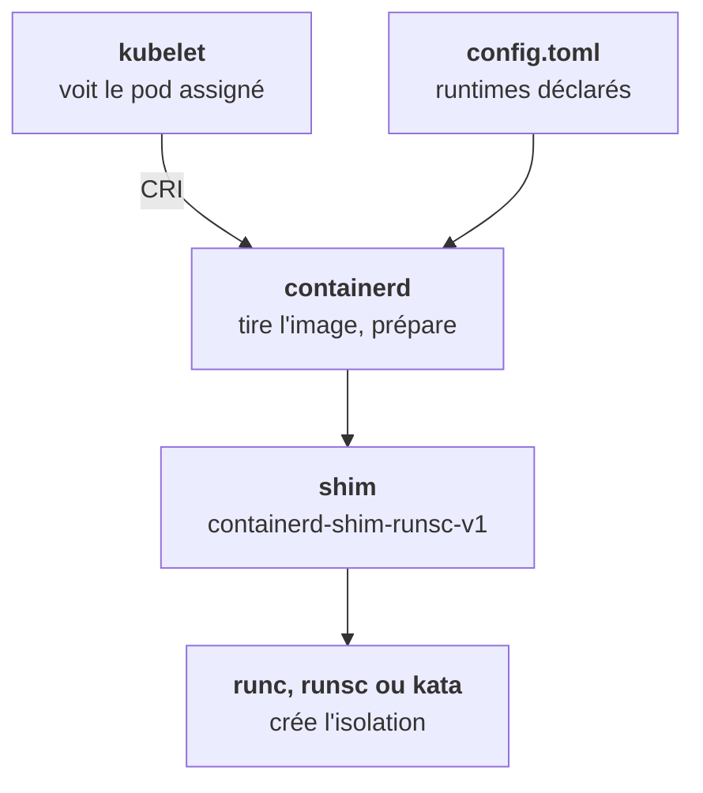

<Idee>
Quand un pod arrive sur un nœud, le **kubelet** demande à **containerd** de le créer, qui lance un **shim**, qui appelle le **runtime** : runc, gVisor ou Kata. Le shim est la prise où l'on branche un autre runtime, et cette prise se configure **sur chaque nœud**.
</Idee>

<Analogie>
Le kubelet est le **gestionnaire de l'immeuble** qui reçoit la commande d'un logement. containerd est l'**entreprise générale**. Le shim est le **contrat de sous-traitance**, et le runtime l'**équipe qui construit** : appartement, appartement à sas ou maison. L'entreprise ne fait appel qu'aux sous-traitants de **sa liste**.
</Analogie>



## La liste, sur le nœud

Chaque runtime est déclaré dans la configuration de containerd, avec un nom (le **handler**) et un type de shim :

```toml
[plugins."io.containerd.grpc.v1.cri".containerd.runtimes.runsc]
  runtime_type = "io.containerd.runsc.v1"   # containerd-shim-runsc-v1
[plugins."io.containerd.grpc.v1.cri".containerd.runtimes.kata]
  runtime_type = "io.containerd.kata.v2"    # containerd-shim-kata-v2
```

Avec containerd 2.x (format `version = 3`), le chemin commence par `plugins."io.containerd.cri.v1.runtime"`.

## Changer de runtime, c'est toucher le nœud

| Étape | Qui la fait |
|---|---|
| Installer les binaires du runtime et du shim | ✘ pas le YAML du pod : un DaemonSet privilégié ou l'image du nœud |
| Déclarer le runtime dans `config.toml` | ✘ idem, sur chaque nœud |
| Redémarrer containerd | ✘ idem |
| Choisir le runtime pour un pod | ✔ le YAML : `runtimeClassName` (leçon 6) |

<Terrain>
Chez un client, l'installation passe souvent par un **DaemonSet privilégié** (`kata-deploy` pour Kata), ou par le fournisseur (GKE Sandbox pour gVisor). Donc une question à poser tôt : as-tu le droit de toucher aux nœuds ?
</Terrain>

<Piege>
Croire que changer de runtime se fait seulement dans le YAML du pod. Le YAML choisit dans la liste du nœud ; il ne l'allonge pas.
</Piege>

<Retenir>
kubelet, CRI, containerd, shim, runtime. Le runtime se branche sur chaque nœud, dans la configuration de containerd ; le pod ne fait que choisir.
</Retenir>
