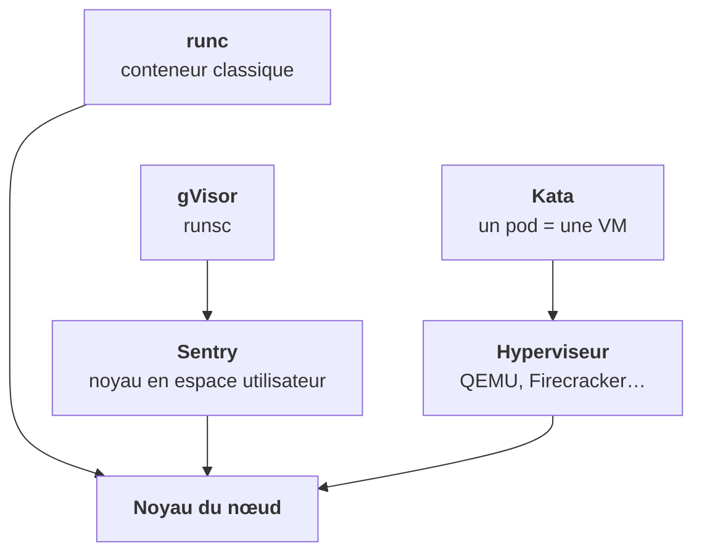

<Idee>
**gVisor** place un faux noyau, écrit comme un programme ordinaire, entre le code et le vrai noyau : il filtre tout. **Kata** lance une **petite VM par pod**, avec son propre noyau. gVisor est le plus simple à déployer ; Kata isole le plus fort.
</Idee>

<Analogie>
**gVisor**, c'est un appartement avec un **sas et un concierge** : chaque demande à la plomberie passe par lui, et il n'en laisse passer qu'une poignée. **Kata**, c'est une **maison individuelle** sur le même terrain : sa propre plomberie. Mais il faut un **terrain constructible** : KVM.
</Analogie>

## Le face-à-face

| | runc | gVisor | Kata |
|---|---|---|---|
| Isolation | ✘ noyau partagé | ✔ noyau filtré | ✔✔ noyau dédié |
| Démarrage | ✔ immédiat | ✔ proche de runc | ✘ plus lent (VM) |
| Prérequis | ✔ aucun | ✔ binaires seuls | ✘ KVM |
| Coût | ✔ aucun | ✘ I/O plus lentes | ✘ mémoire par VM |
| GPU | ✔ | ✘ partiel (NVIDIA) | ✘ passthrough complexe |

FUSE et GPU dépendent du runtime et de sa version : à vérifier pour chaque client.

<Compare>
<Cas titre="gVisor">

- Aucun matériel spécial
- Intégré à GKE
- I/O plus lentes

</Cas>
<Cas titre="Kata">

- Une micro-VM par pod
- Bare metal ou imbriqué
- Mémoire en plus

</Cas>
</Compare>

<Terrain>
Sur GKE, gVisor s'appelle **GKE Sandbox** : un node pool dédié (pas celui par défaut) et `runtimeClassName: gvisor`. Pour Kata sur un cloud, demande si les instances offrent la **virtualisation imbriquée** ; sinon, il faut du bare metal.
</Terrain>

<Retenir>
gVisor est le choix facile par défaut ; Kata est le plus fort, mais il a besoin de nœuds compatibles. Le bon mur dépend d'abord des nœuds du client.
</Retenir>
