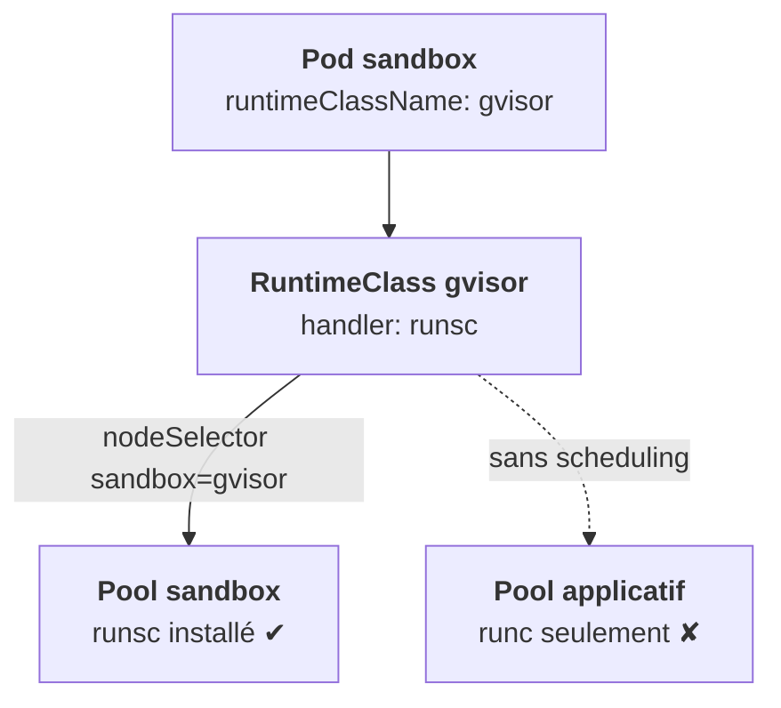

<Idee>
Une **RuntimeClass** donne un nom Kubernetes à un runtime installé sur les nœuds. Le pod la choisit avec un seul champ, `runtimeClassName`. Elle peut aussi l'envoyer vers les bons nœuds et compter ce que le runtime consomme en plus.
</Idee>

<Analogie>
La RuntimeClass est la **case cochée sur le bon de commande** : « appartement à sas ». Elle nomme le sous-traitant (`handler`), ajoute les **charges** de ce logement (`overhead`) et précise « seulement dans les **immeubles équipés** » (`scheduling`).
</Analogie>

## Trois champs qui comptent

| Champ | Ce qu'il fait |
|---|---|
| `handler` | ✔ relie au runtime déclaré sur le nœud |
| `overhead` | ✔ compte la VM ou le Sentry dans le scheduling et les quotas |
| `scheduling` | ✔ envoie le pod vers les nœuds équipés |

Le schéma classique : un **node pool dédié aux sandboxes**, avec un label (il attire les sandboxes) et un taint `NoSchedule` (il repousse le reste).

<Piege>
Une RuntimeClass qui pointe vers des nœuds où le runtime n'est pas installé : pod en `ContainerCreating` ou en erreur au démarrage, event `FailedCreatePodSandBox`. Lis les events, puis `kubectl get nodes -L sandbox`.
</Piege>

<Retenir>
La RuntimeClass choisit le mur, pod par pod, parmi ceux que les nœuds ont. Son `scheduling` doit envoyer le pod là où ce mur existe.
</Retenir>
