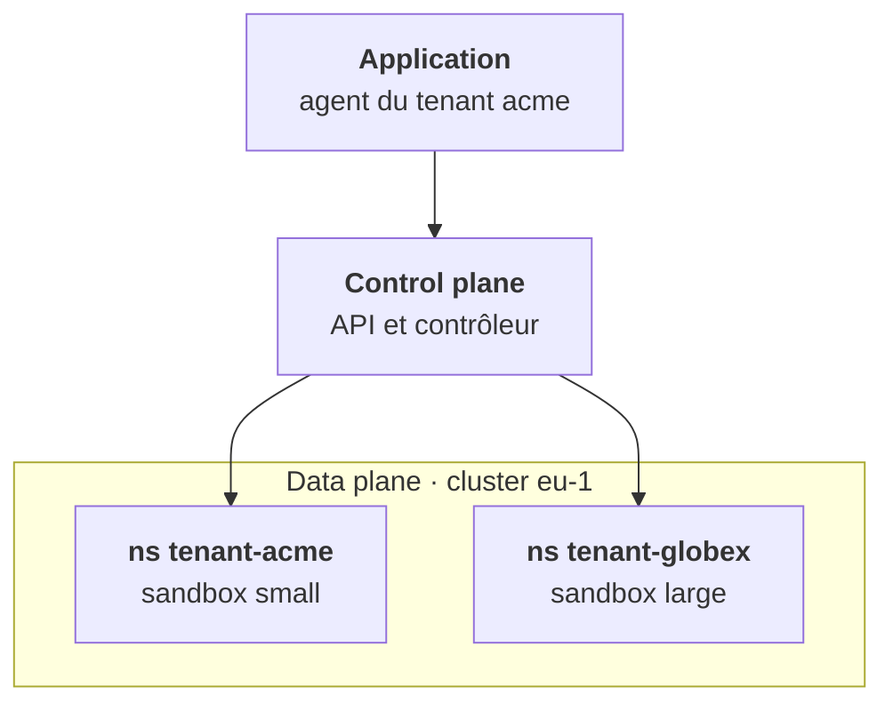

<Idee>
Un service de sandboxes a deux plans : un **control plane**, l'API qui reçoit les demandes et crée les pods, et un **data plane**, le ou les clusters où ils tournent, avec un **namespace par tenant**. Isoler, c'est répondre à trois questions distinctes.
</Idee>

<Analogie>
Le control plane est l'**agence de location** : elle reçoit les demandes et signe les baux. Le data plane, ce sont les **résidences**, avec un **étage par locataire**. La taille du logement (T2, T4), c'est l'instance type.
</Analogie>

## Le vocabulaire

| Mot | Ce que c'est |
|---|---|
| Tenant | Le client ou l'organisation qui possède les sandboxes |
| Région | Un cluster de data plane et un namespace dedans |
| Instance type | Un preset : CPU, mémoire, disque |

Les noms exacts dépendent de ton produit : à vérifier.

## Trois questions à ne pas confondre

| Question | Qui y répond |
|---|---|
| La sandbox est-elle isolée **du nœud** ? | ✔ le runtime : gVisor, Kata |
| Les sandboxes sont-elles isolées **entre elles** ? | ✔ namespaces, RBAC, NetworkPolicy, quotas (leçon 8) |
| **Qui** a le droit d'appeler l'API qui les crée ? | ✔ l'authentification du control plane (étape 13) |

<Compare>
<Cas titre="Même cluster">

- Un seul cluster à opérer
- API server partagé
- L'appli subit les rafales

</Cas>
<Cas titre="Cluster séparé">

- Charge isolée
- Un cluster de plus
- Réseau à ouvrir vers lui

</Cas>
</Compare>

<Terrain>
Le projet `kubernetes-sigs/agent-sandbox` est un exemple de contrôleur générique : une ressource `Sandbox`, un modèle, une demande et un pool de sandboxes prêtes, au-dessus d'une RuntimeClass. Ton produit a peut-être le sien ; le principe est le même.
</Terrain>

<Retenir>
Une isolation forte du runtime ne remplace pas l'authentification de l'API. Trois questions, trois réponses : le runtime, le cluster, l'API.
</Retenir>
