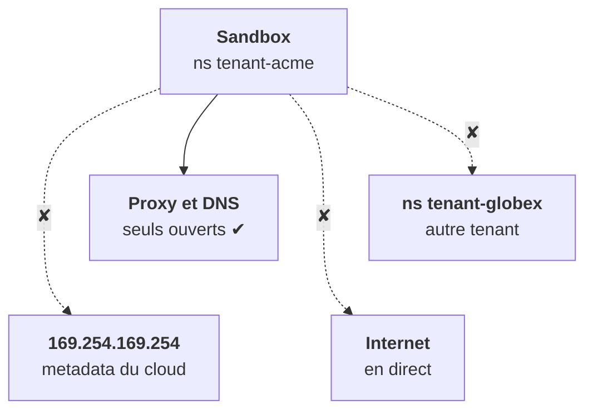

<Idee>
Le runtime isole la sandbox du nœud. Le reste, c'est le cluster qui le garantit, namespace par namespace : des **droits limités**, des **quotas**, un **réseau fermé par défaut**, surtout en sortie, et un **règlement** qui refuse les pods dangereux.
</Idee>

<Analogie>
Chaque locataire a un **badge** limité à son étage (RBAC), un **quota** de logements et une taille maximale (quotas), des **portes extérieures fermées** par défaut (NetworkPolicy), et un **règlement d'urbanisme** à l'entrée (Pod Security). Le **local du gardien**, avec les clés de tout l'immeuble, est l'endpoint de metadata.
</Analogie>

## Cinq garde-fous par namespace de tenant

| Garde-fou | Ce qu'il empêche |
|---|---|
| RBAC limité au namespace | ✘ créer des pods ailleurs ; pas de jeton d'API dans la sandbox |
| ResourceQuota | ✘ un tenant qui remplit le cluster |
| LimitRange | ✘ un pod sans limites ou démesuré |
| NetworkPolicy par défaut, egress compris | ✘ joindre voisins, services internes, metadata, Internet |
| Pod Security Admission | ✘ un pod privilégié ou monté sur le nœud |

Les pods sandbox n'ont pas besoin de parler à l'API Kubernetes : `automountServiceAccountToken: false` leur retire le jeton.

<Compare>
<Cas ton="ko" titre="Ingress seul">

- L'entrée est fermée
- La sortie est ouverte
- Metadata joignable

</Cas>
<Cas ton="ok" titre="Ingress et egress">

- Tout fermé par défaut
- Proxy et DNS ouverts
- Metadata bloquée

</Cas>
</Compare>

<Piege>
Une NetworkPolicy ne fait rien si le CNI ne l'applique pas (étape 4). Teste-la depuis une sandbox avant de la déclarer en place.
</Piege>

<Retenir>
Le runtime protège le nœud ; RBAC, quotas, NetworkPolicy et Pod Security protègent les tenants les uns des autres. Et on ferme d'abord l'egress, metadata du cloud comprise.
</Retenir>
