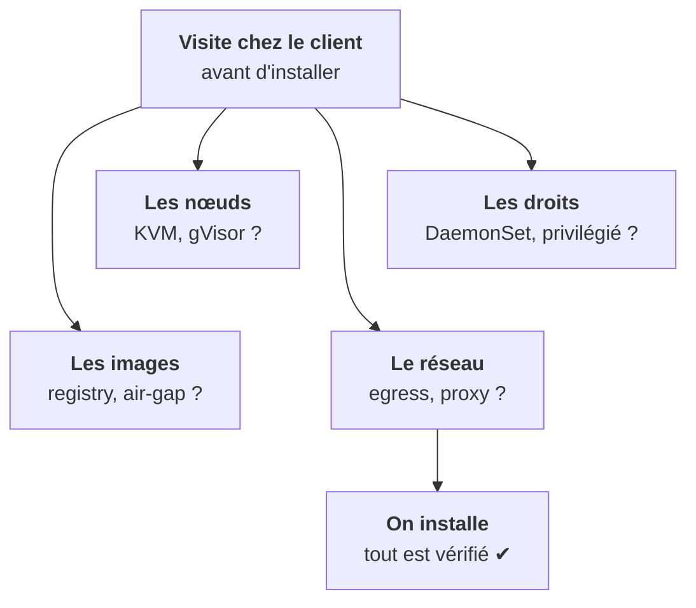

<Idee>
Avant d'installer des sandboxes chez un client, on vérifie quatre choses : **les nœuds** (KVM, gVisor), **les droits** (DaemonSet privilégié, mode privilégié), **les images** (registry, air-gap) et **le réseau** (egress, proxy). Chaque réponse manquante casse quelque chose.
</Idee>

<Analogie>
C'est la **visite technique avant le chantier** : le terrain est-il constructible (KVM) ? A-t-on le droit d'entrer dans les locaux techniques (DaemonSet) ? Les matériaux sont-ils livrés sur place (registry) ? Par où passent les livraisons (egress) ?
</Analogie>

## Question, et ce qui casse sinon

| Question | Sans réponse |
|---|---|
| Les nœuds ont-ils KVM, ou gVisor ? | ✘ RuntimeClass inutilisable |
| Peut-on déployer un DaemonSet privilégié ? | ✘ impossible de configurer les nœuds |
| Le mode privilégié ou FUSE est-il accepté ? | ✘ synchronisation des fichiers, plus lente |
| Quel registry, quel secret de pull ? | ✘ `ImagePullBackOff` |
| Toutes les images sont-elles copiées, même celles ajoutées à l'exécution ? | ✘ client air-gapped bloqué |
| Quelle politique d'egress ? | ✘ la sandbox ne joint pas son proxy, ou joint Internet |
| Un cluster dédié aux sandboxes ? | ✘ le cluster applicatif sous pression |

<Piege>
`imagePullPolicy: Always` interroge le registry **à chaque création** de sandbox : démarrage plus lent, registry chargé, et toutes les sandboxes échouent s'il tombe. Préfère un tag fixe avec `IfNotPresent`.
</Piege>

<Terrain>
Pose ces questions dans le même document que celles du reste de la plateforme (étape 10). La réponse sur KVM décide souvent à elle seule entre gVisor et Kata.
</Terrain>

<Retenir>
Il faut vérifier les nœuds, les droits, les images et le réseau avant d'installer quoi que ce soit. Une question oubliée se découvre le jour J, en `ContainerCreating` ou en `ImagePullBackOff`.
</Retenir>
