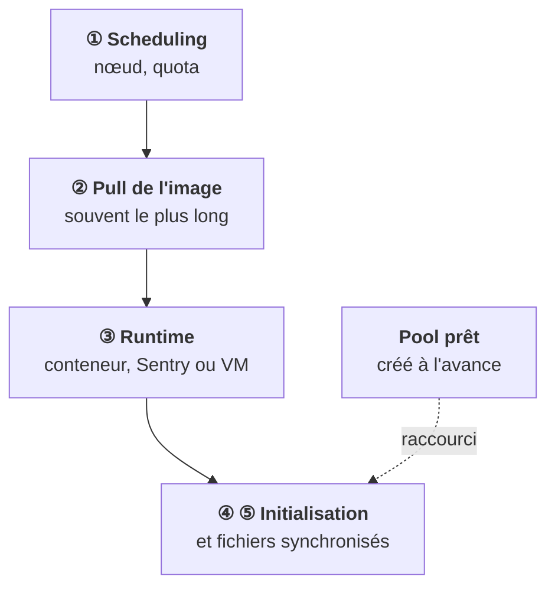

<Idee>
Une sandbox neuve paie à chaque fois le **démarrage à froid** : trouver un nœud, tirer l'image, lancer le runtime, s'initialiser, copier les fichiers. Pour aller vite, on prépare **à l'avance**. Pour diagnostiquer, on descend : le pod, le contrôleur, le nœud.
</Idee>

<Analogie>
Construire un logement à chaque location, puis le démolir, c'est long. On garde des **logements meublés prêts à louer** (le pool), les **matériaux déjà sur place** (images pré-téléchargées), ou des **maisons préfabriquées** (snapshots).
</Analogie>

## Les leviers

| Levier | Ce qu'il retire |
|---|---|
| Pool de sandboxes prêtes | ✔ tout le chemin, au prix de ressources réservées |
| Images pré-téléchargées sur les nœuds | ✔ le pull |
| Snapshots, selon le runtime | ✔ une partie du runtime et de l'initialisation |

## Diagnostiquer, dans l'ordre

| Où | Ce que tu y lis |
|---|---|
| ① Events du pod | ✔ `FailedScheduling`, `ImagePullBackOff`, `FailedCreatePodSandBox` |
| ② Logs du contrôleur | ✔ demande reçue ? pod créé ? refusé par RBAC, quota, Pod Security ? |
| ③ Le nœud | ✔ `crictl`, logs de containerd : erreurs du shim ou du runtime |

<Compare>
<Cas titre="Créée à la demande">

- Neuve à chaque tâche
- Paie tout le démarrage
- Aucune réserve

</Cas>
<Cas titre="Pool prêt">

- Neuve aussi
- Attribuée tout de suite
- Ressources réservées

</Cas>
</Compare>

<Terrain>
Pas de pod du tout ? Ne cherche pas sur le nœud : commence par le contrôleur. Un pod bloqué ? Ses events disent presque toujours à quel étage.
</Terrain>

<Retenir>
« Jetable » et « rapide » s'opposent. Le pool de sandboxes prêtes est le compromis : des sandboxes neuves, mais créées avant qu'on en ait besoin.
</Retenir>
