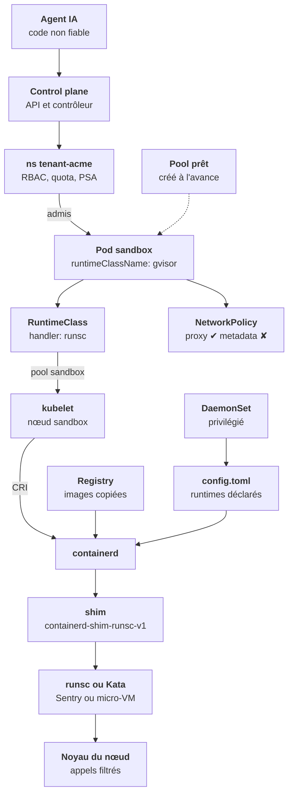
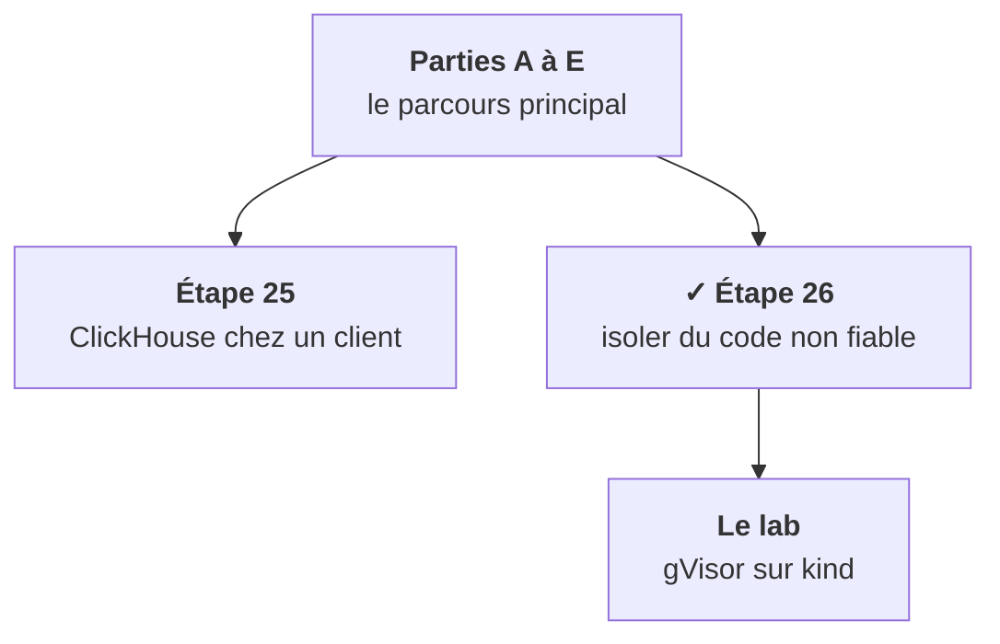

Le code d'un agent est non fiable par définition : on ne le filtre pas, on le **contient**. Un conteneur ordinaire ne suffit pas, parce que tous partagent le noyau du nœud. On change donc de mur (gVisor, Kata), et on l'entoure de garde-fous.

Le fil rouge, ce sont **trois murs pour trois questions** : l'API décide **qui** peut créer une sandbox, le cluster isole les tenants **entre eux**, le runtime isole la sandbox **du nœud**. Aucun ne remplace les autres. Et le mur du runtime se pose **sur le nœud**, pas dans le YAML. Regarde les couleurs : le violet est ce que tu déclares, l'ambre ce qui travaille, le vert la sandbox, le bleu ce qui vient de dehors. Lance le pas à pas avec ▶, ou avance avec ›.

## Ce que tu sais faire maintenant

- **Dire ce qu'est une sandbox** et pourquoi le code d'un agent est non fiable. [Leçon 1](/l/26-sandboxes/01-sandbox-pourquoi/)
- **Expliquer ce qu'isole un conteneur**, et sa limite : le noyau partagé. [Leçon 2](/l/26-sandboxes/02-conteneur-pas-vm/)
- **Peser le mode privilégié et FUSE**, et proposer la synchronisation. [Leçon 3](/l/26-sandboxes/03-privilegie-fuse/)
- **Tracer la chaîne** kubelet, containerd, shim, runtime. [Leçon 4](/l/26-sandboxes/04-chaine-runtime/)
- **Choisir entre gVisor et Kata** selon les nœuds du client. [Leçon 5](/l/26-sandboxes/05-gvisor-kata/)
- **Lire une RuntimeClass** et reconnaître le runtime absent. [Leçon 6](/l/26-sandboxes/06-runtimeclass/)
- **Séparer les trois questions** d'isolation d'un service multi-tenant. [Leçon 7](/l/26-sandboxes/07-multi-tenant/)
- **Poser les garde-fous** d'un namespace de tenant, egress compris. [Leçon 8](/l/26-sandboxes/08-garde-fous/)
- **Poser les bonnes questions** au client avant d'installer. [Leçon 9](/l/26-sandboxes/09-questions-client/)
- **Accélérer le démarrage et diagnostiquer** dans l'ordre pod, contrôleur, nœud. [Leçon 10](/l/26-sandboxes/10-demarrage-diagnostic/)

## Les mots de l'étape

| Mot | En une phrase | Dans l'immeuble |
|---|---|---|
| Sandbox | Un environnement jetable pour du code non fiable. | Le logement prêté pour une nuit |
| Noyau | Le cœur du système, partagé par tous les conteneurs d'un nœud. | La plomberie commune |
| Namespaces | Ce qu'un processus voit. | Les murs |
| cgroups | Ce qu'un processus consomme. | Les compteurs |
| seccomp, capabilities | Ce qu'un processus peut demander au noyau. | Le règlement des robinets |
| Mode privilégié | Presque tous les droits sur le nœud. | Les clés du local technique |
| Shim | Le lien entre containerd et le runtime, la prise où l'on branche. | Le contrat de sous-traitance |
| gVisor | Un noyau en espace utilisateur qui filtre les appels système. | Le sas et le concierge |
| Kata | Une micro-VM par pod, avec son propre noyau. | La maison individuelle |
| KVM | La virtualisation matérielle dont Kata a besoin. | Le terrain constructible |
| RuntimeClass | Le nom Kubernetes d'un runtime, choisi par le pod. | La case cochée sur le bon de commande |
| Control plane | L'API qui reçoit les demandes et crée les sandboxes. | L'agence de location |
| Tenant | Le client qui possède des sandboxes, dans son namespace. | Le locataire et son étage |
| Pool prêt | Des sandboxes neuves créées à l'avance. | Les logements meublés prêts à louer |

## Où tu en es dans la partie F

Comme l'étape 25, c'est un cas pratique hors du parcours principal : il applique à une brique précise l'architecture de l'étape 1 (kubelet, containerd), le réseau de l'étape 4, les accès de l'étape 6 et l'identité de l'étape 13. Le lab te fait brancher gVisor à la main sur ton cluster kind, exactement ce qu'un DaemonSet ferait chez le client.

<Retenir>
Trois murs pour trois questions : l'API décide qui crée, le cluster isole les tenants, le runtime isole du nœud. Le runtime s'installe sur les nœuds, la RuntimeClass ne fait que le choisir. Et avant d'installer, on vérifie les nœuds, les droits, les images et le réseau.
</Retenir>
